# Apache Kafka --- Core Concepts, Producer, Consumer, Streams & Exactly-Once Semantics

> Cleaned and corrected from handwritten notes. The flow follows the
> original page/image order, while inaccurate or outdated statements are
> corrected.

## Table of Contents

1.  [Kafka Fundamentals](#1-kafka-fundamentals)
2.  [Topics, Partitions, Keys and
    Retention](#2-topics-partitions-keys-and-retention)
3.  [Kafka APIs](#3-kafka-apis)
4.  [Producer Internals](#4-producer-internals)
5.  [Producer Batching, Acknowledgements and
    Failure](#5-producer-batching-acknowledgements-and-failure)
6.  [Consumers and Consumer Groups](#6-consumers-and-consumer-groups)
7.  [Polling and Consumer Liveness](#7-polling-and-consumer-liveness)
8.  [Offsets and Commits](#8-offsets-and-commits)
9.  [Kafka Streams](#9-kafka-streams)
10. [Stateful Stream Processing](#10-stateful-stream-processing)
11. [Broker Failure and Replication](#11-broker-failure-and-replication)
12. [Duplicate Messages and Idempotent
    Producer](#12-duplicate-messages-and-idempotent-producer)
13. [Kafka Transactions](#13-kafka-transactions)
14. [Consumer Failure Scenarios](#14-consumer-failure-scenarios)
15. [Exactly-Once Stream Processing](#15-exactly-once-stream-processing)
16. [Corrections to the Original
    Notes](#16-corrections-to-the-original-notes)
17. [Interview Summary](#17-interview-summary)
18. [Spring Kafka Consumer Failure Handling, Retries and DLT](#part-iii--spring-kafka-consumer-failure-handling-retries-and-dlt)

------------------------------------------------------------------------

## 1. Kafka Fundamentals

Apache Kafka is a **distributed event-streaming platform** built around
an append-only distributed log.

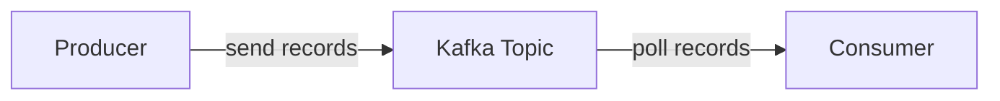

A producer writes records to a topic. Consumers **subscribe** to topics
and repeatedly **poll** Kafka for records.

### Kafka versus traditional messaging/JMS

A useful conceptual distinction is:

-   Kafka records are retained according to the topic's **retention
    policy**, even after consumers read them.
-   Consumers maintain their own logical position using **offsets**, so
    records can be replayed while they are still retained.
-   Traditional queue-oriented messaging commonly emphasizes
    delivery/acknowledgement and removal or expiration rather than
    Kafka's durable shared-log model.

Kafka is therefore commonly described as **store and replay**, rather
than simply **deliver once and delete**.

> **Correction:** Kafka is not literally a "circular buffer." A
> partition is an **append-only log made of segment files**. Retention
> can make its *storage behavior* resemble a bounded rolling log because
> old segments are deleted, but records are not overwritten one-by-one
> as in a circular buffer.

### Retention

Typical retention mechanisms include:

-   **Time based** --- e.g. retain records for a configured period.
-   **Size based** --- old log segments can be removed when configured
    storage limits are exceeded.
-   **Log compaction** --- for compacted topics, Kafka can retain the
    latest value for each key rather than treating retention purely as
    time/size deletion.

A slow consumer can continue reading old records **only while those
records remain available under the topic's retention/compaction
policy**.

------------------------------------------------------------------------

## 2. Topics, Partitions, Keys and Retention

A Kafka topic is divided into one or more **partitions**.

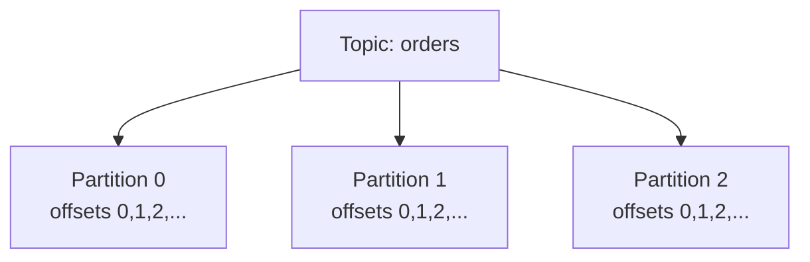

Each Kafka record conceptually contains:

``` text
ProducerRecord
 ├── topic
 ├── partition       (optional)
 ├── timestamp       (optional)
 ├── key             (optional)
 ├── value
 └── headers         (optional)
```

> **Correction:** A record does **not** have to contain a key. The key
> is optional.

### How a partition is selected

If an explicit partition is supplied, Kafka uses it.

Otherwise, the producer's partitioning logic selects a partition. For
keyed records, the default partitioner uses a deterministic hash-based
mapping so the **same key normally maps to the same partition while the
partition count remains unchanged**.

A simplified mental model is:

``` text
key
 ↓
serialize key
 ↓
hash
 ↓
map hash to available partition
```

Do not rely on the simplified formula:

``` text
hash(key) % numberOfPartitions
```

as the exact implementation contract. Kafka's default partitioning
implementation and behavior for null keys have evolved.

### Ordering guarantee

Kafka guarantees record ordering **within a partition**, not across the
entire topic.

Therefore, using the same business key---such as `customerId` or
`deviceId`---is a common way to keep related events ordered in one
partition.

------------------------------------------------------------------------

## 3. Kafka APIs

The main Kafka APIs/ecosystem components are:

1.  **Producer API** --- publish records.
2.  **Consumer API** --- consume records.
3.  **Kafka Streams** --- build stream-processing applications.
4.  **Kafka Connect** --- integrate Kafka with external systems.
5.  **Admin API** --- manage and inspect Kafka resources.

> **Correction:** What older material sometimes calls the "Core API" is
> better represented today by Kafka's client/common functionality and
> the **Admin API**. "Publisher API" is normally called the **Producer
> API**.

### Kafka Connect

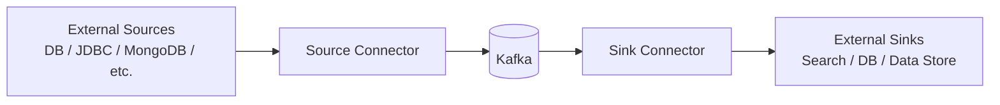

Connectors available for a particular technology depend on the Kafka
Connect ecosystem/vendor; Kafka itself does not automatically include
every database connector.

### Common Kafka use cases

Messaging, event-driven architectures, metrics pipelines, log
aggregation, stream processing, event sourcing, audit/event logs, CDC
pipelines, and data integration are common use cases.

------------------------------------------------------------------------

## 4. Producer Internals

Calling `KafkaProducer.send()` does **not normally mean a synchronous
network write for that individual record**.

A simplified producer path is:

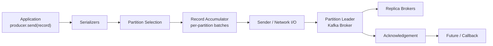

### Important producer concepts

The producer serializes the key/value, determines the target partition,
appends the record to an in-memory **RecordAccumulator**, and a
background sender sends batches to the broker.

Conceptually:

``` text
RecordAccumulator
 ├── Topic A / Partition 0 -> batch -> batch -> ...
 ├── Topic A / Partition 1 -> batch -> ...
 └── Topic B / Partition 0 -> batch -> ...
```

This batching improves throughput by reducing the number of network
requests.

### Important correction: when does a batch get sent?

The original notes suggest that records wait until a buffer becomes
"full based on size or time."

That is too strict.

`batch.size` is primarily a **target/upper batching size**, while
`linger.ms` allows the producer to wait briefly for additional records.
A batch may be sent **before `batch.size` is reached** for several
reasons, including sender activity and other producer conditions.

So think:

``` text
send()
  ↓
append to per-partition batch
  ↓
batch becomes eligible/ready to send
  ↓
Sender sends ProduceRequest
```

---not "Kafka always waits until the batch is full."

### What if the producer process crashes?

Records that exist **only in producer memory and have not been
successfully acknowledged by Kafka can be lost** if the process/machine
dies.

A graceful `producer.close()` attempts to flush outstanding records. An
abrupt crash provides no such guarantee.

------------------------------------------------------------------------

## 5. Producer Batching, Acknowledgements and Failure

`send()` returns a future and can also use a callback.

``` java
producer.send(record, (metadata, exception) -> {
    if (exception != null) {
        // send ultimately failed
    } else {
        // record acknowledged according to producer configuration
    }
});
```

The callback is invoked when the send completes successfully or fails
after the applicable retry behavior.

### `acks`

The main acknowledgement modes are:

  -----------------------------------------------------------------------
  Setting                             Meaning
  ----------------------------------- -----------------------------------
  `acks=0`                            Producer does not wait for a broker
                                      acknowledgement.

  `acks=1`                            Partition leader acknowledges after
                                      writing the record locally.

  `acks=all` / `-1`                   Leader waits for all **in-sync
                                      replicas required by the
                                      acknowledgement rules**.
  -----------------------------------------------------------------------

> **Correction:** `acks=all` does not mean "wait for every configured
> replica regardless of state." Durability also depends on replication
> configuration such as `min.insync.replicas`.

### Retry path

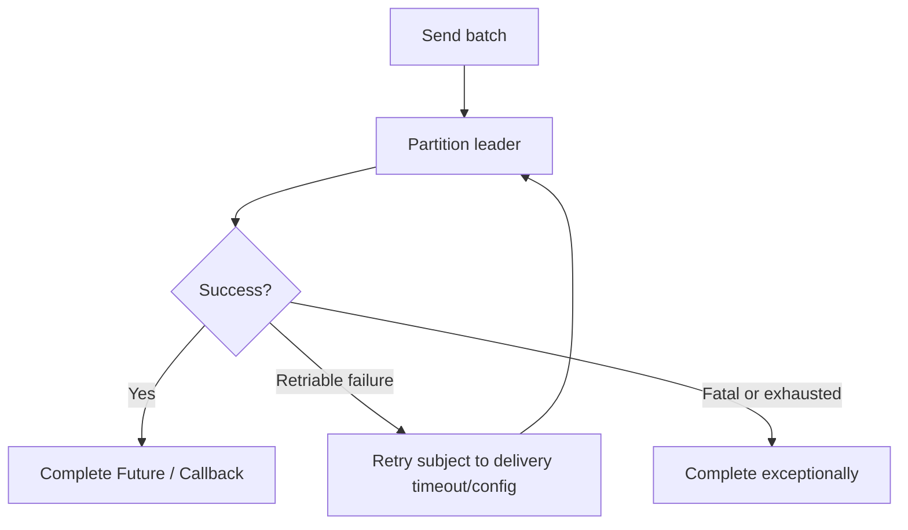

Kafka's producer can retry **retriable** failures automatically. Not
every error is retryable.

------------------------------------------------------------------------

## 6. Consumers and Consumer Groups

Kafka consumers are usually members of a **consumer group**, identified
by `group.id`.

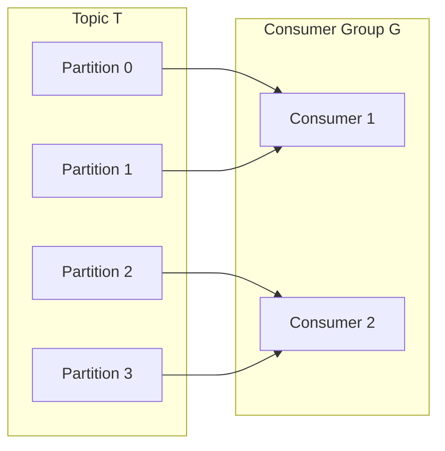

Within a consumer group, a partition is assigned to **at most one
consumer at a time**. One consumer can own multiple partitions.

If there are more consumers than partitions, some consumers remain idle.

### Subscription

``` java
consumer.subscribe(Collections.singletonList("customerStates"));
```

Multiple topics can be subscribed to.

Pattern subscription is also possible:

``` java
consumer.subscribe(Pattern.compile("customer-.*"));
```

This is useful when matching topics may be created later.

------------------------------------------------------------------------

## 7. Polling and Consumer Liveness

Modern Kafka uses:

``` java
ConsumerRecords<String, String> records =
        consumer.poll(Duration.ofMillis(100));
```

The duration tells `poll()` how long it may wait for data before
returning.

A typical loop is:

``` java
while (true) {
    ConsumerRecords<String, String> records =
            consumer.poll(Duration.ofMillis(100));

    for (ConsumerRecord<String, String> record : records) {
        process(record);
    }
}
```

### `max.poll.interval.ms`

This is a key consumer liveness setting.

It limits how much time may pass **between calls to `poll()`** before
Kafka considers the consumer unable to make progress and triggers
group-management consequences/reassignment.

The common default is **5 minutes**, not 3 seconds.

> **Major correction:** The handwritten note says roughly "if the
> consumer does not poll within 3 seconds Kafka rebalances." That
> confuses different settings. `max.poll.interval.ms` is normally
> measured in minutes; heartbeat/session settings are separate.

### `max.poll.records`

This limits the maximum number of records returned by one `poll()` call.

When processing is expensive, tune `max.poll.records` together with
`max.poll.interval.ms` so the application can finish processing and poll
again in time.

------------------------------------------------------------------------

## 8. Offsets and Commits

Every record in a partition has an **offset**.

``` text
Partition 0

offset:   0    1    2    3    4
record:  M1   M2   M3   M4   M5
```

A consumer group's committed offset represents the position from which
that group should resume.

### Important offset nuance

Kafka commits the **next offset to read**, not conceptually "the last
processed record number."

If offset `4` has been successfully processed, the committed position is
normally `5`.

### Automatic commits

With:

``` properties
enable.auto.commit=true
auto.commit.interval.ms=5000
```

the consumer periodically commits offsets for records returned by
`poll()`.

> **Correction:** It is misleading to say the consumer "commits the
> largest offset received from `poll()` every five seconds." Auto-commit
> occurs periodically as part of consumer polling behavior, and
> committing records merely because they were returned---not because
> business processing safely completed---can cause message loss after a
> failure.

### Manual commits

For more processing control:

``` properties
enable.auto.commit=false
```

and use `commitSync()` or `commitAsync()` after the desired processing
boundary.

Manual commits can reduce the risk of committing records before
processing, but they do **not by themselves create exactly-once
processing**.

------------------------------------------------------------------------

## 9. Kafka Streams

Consider hospital monitoring devices emitting heartbeat events.

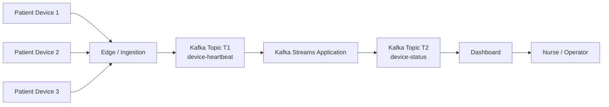

`T1` contains raw heartbeat/sensor events. A stream-processing
application derives higher-level status events and writes them to `T2`.

Example:

``` json
// T1
{
  "deviceId": "1234",
  "timestamp": "..."
}
```

Derived event:

``` json
// T2
{
  "deviceId": "1234",
  "deviceStatus": "PASS"
}
```

or:

``` json
{
  "deviceId": "1234",
  "deviceStatus": "FAIL"
}
```

Kafka Streams applications are ordinary JVM applications that consume
from Kafka, process/transform records, optionally maintain state, and
produce results back to Kafka.

------------------------------------------------------------------------

## 10. Stateful Stream Processing

Suppose the rule is:

> If no heartbeat has been observed for a device for more than two
> seconds, produce an OFFLINE event; when heartbeat resumes, produce
> ONLINE.

That requires **state** such as the last-seen time for each `deviceId`.

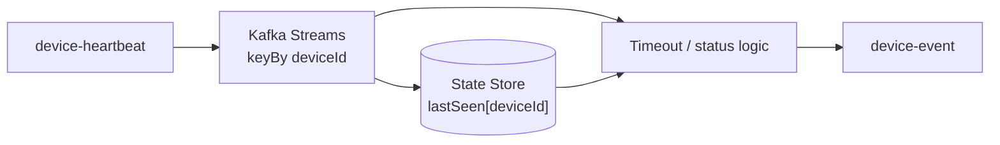

### Why plain consumer instances can be tricky

If related events for the same device were processed by unrelated
instances without a correctly partitioned/stateful model, local state
could become inconsistent during scaling or rebalancing.

Kafka Streams addresses this with:

-   key-based partitioning,
-   partition/task ownership,
-   local state stores,
-   changelog topics for recoverability,
-   task migration/rebalancing.

> **Correction:** Kafka Streams is not required merely because
> rebalancing exists. A carefully designed plain Consumer application
> can maintain state too. Kafka Streams provides a framework that makes
> partitioned, fault-tolerant stateful processing substantially easier.

For per-device state, events should normally be keyed by `deviceId` so
events for the same device are routed consistently to the same
partition/task.

------------------------------------------------------------------------

## 11. Broker Failure and Replication

Kafka partitions can be replicated across brokers.

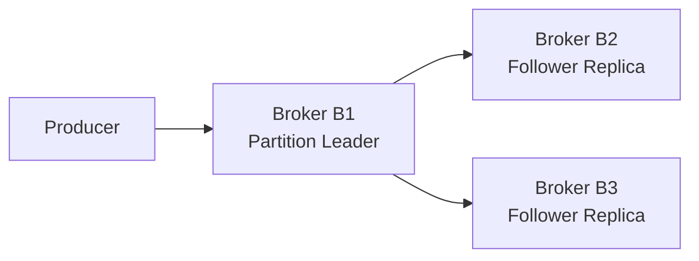

If the leader broker fails, Kafka's controller/cluster metadata
mechanism can elect an eligible replica as the new leader.

> **Correction:** Calling this a "Kafka cluster automatically elects a
> leader" is fine at a high level, but modern Kafka clusters use the
> **KRaft controller quorum** for cluster metadata and leader-management
> decisions. Older deployments may use ZooKeeper-based coordination.

Replication protects against broker failure, subject to replication
factor, in-sync replicas, acknowledgement configuration, and failure
conditions.

------------------------------------------------------------------------

## 12. Duplicate Messages and Idempotent Producer

Consider:

``` text
Producer -> Leader: M1
Leader stores M1
Leader -> Producer: ACK   X lost
Producer retries M1
```

Without duplicate protection, the retry could append the same logical
send again.

### Idempotent producer

Kafka's idempotent producer attaches producer identity and sequence
information so the broker can detect duplicate retries **for a producer
session and partition**.

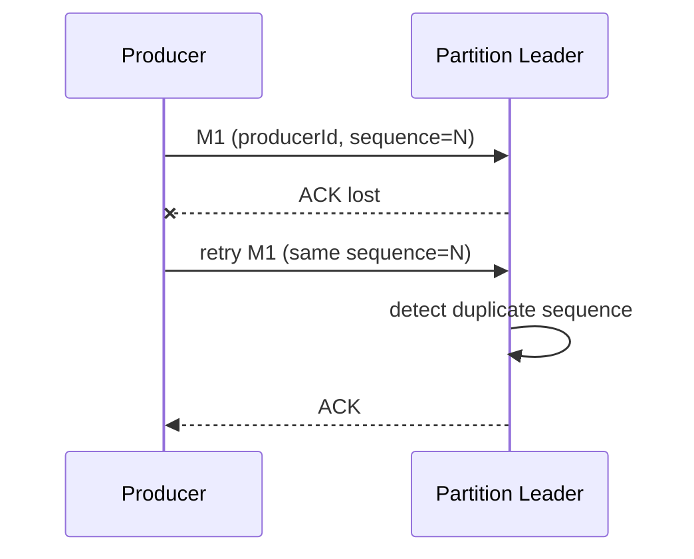

Benefits include protection against duplicates caused by producer
retries and preservation of ordering under supported producer
configurations.

Modern Kafka producer defaults make idempotence easier to use;
explicitly setting:

``` properties
enable.idempotence=true
```

makes the intent clear.

> **Correction:** Idempotence is not a universal "exactly once"
> guarantee for all business effects. It primarily prevents duplicate
> writes caused by producer retries within Kafka's producer protocol.

------------------------------------------------------------------------

## 13. Kafka Transactions

Idempotence protects individual producer retry behavior.
**Transactions** provide atomicity across multiple Kafka writes and can
also atomically combine consumed offsets with produced records.

Conceptually:

``` java
producer.initTransactions();

try {
    producer.beginTransaction();

    producer.send(record1);
    producer.send(record2);

    producer.commitTransaction();
} catch (Exception e) {
    producer.abortTransaction();
}
```

### Atomic writes

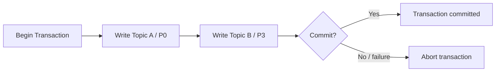

For consumers configured with `isolation.level=read_committed`, records
from aborted transactions are not returned as committed application
data.

### Read-process-write transaction

A powerful Kafka pattern is:

``` text
consume input records
       ↓
process
       ↓
produce output records
       +
send consumed offsets to transaction
       ↓
commit one Kafka transaction
```

This atomically ties the output records to the input offsets in Kafka.

------------------------------------------------------------------------

## 14. Consumer Failure Scenarios

Two classic problems explain why offset timing matters.

### A. Message loss

Suppose:

1.  `poll()` returns `M1...M10`.
2.  The consumer commits the position covering those records **before
    processing finishes**.
3.  It processes only `M1...M5`.
4.  The consumer crashes.
5.  Another consumer resumes from the committed position after `M10`.

Then `M6...M10` may not be processed by the group.

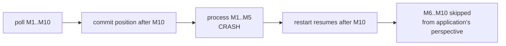

### B. Duplicate processing

Suppose:

1.  `poll()` returns `M1...M10`.
2.  The application processes `M1...M5`.
3.  It crashes **before committing**.
4.  Another consumer resumes from the older committed offset.
5.  `M1...M5` can be delivered and processed again.

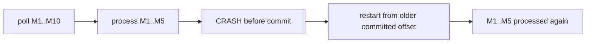

This is the classic trade-off behind **at-most-once** versus
**at-least-once** processing.

------------------------------------------------------------------------

## 15. Exactly-Once Stream Processing

Kafka Streams can provide **exactly-once processing semantics for
Kafka-managed read-process-write state/results**.

The important idea is not that user code can never execute twice. During
retries/recovery, processing may be attempted again.

Instead, Kafka ensures that the committed Kafka-visible result is
consistent **as if each input record affected the transactional Kafka
state/output once**.

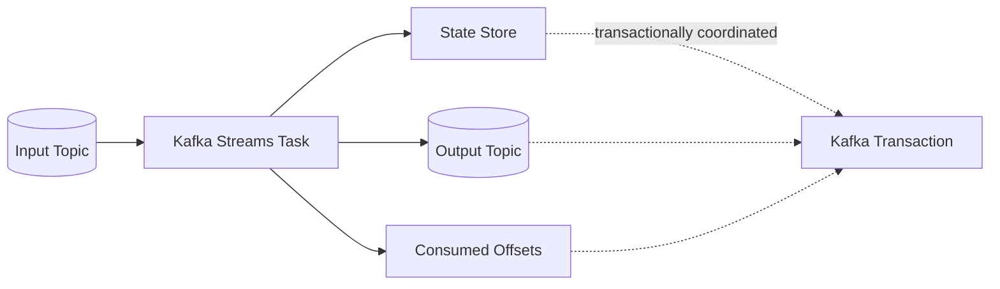

### External side effects

Exactly-once Kafka semantics do **not automatically make arbitrary
external side effects exactly once**.

For example:

``` text
Kafka Streams -> call payment API
Kafka Streams -> send email
Kafka Streams -> update non-transactionally coordinated external DB
```

Such effects need their own idempotency/transaction/outbox strategy.

### Configuration

For Kafka Streams, the important application configuration is:

``` properties
processing.guarantee=exactly_once_v2
```

> **Major correction:** The handwritten notes list
> `processing.mode="exactlyOnce"`. The Kafka Streams setting is
> `processing.guarantee`, and modern Kafka uses `exactly_once_v2` (with
> `exactly_once` being older terminology/configuration).

You normally **do not manually configure** old producer recipes such as:

``` properties
max.in.flight.requests.per.connection=1
acks=all
retries=MAX_INT
```

just to obtain modern idempotence/exactly-once behavior. Kafka's client
configuration enforces compatible settings when idempotence is enabled,
and Kafka Streams manages its transactional producers for EOS.

### Consumer isolation

For applications directly reading transactional Kafka records and
wanting only committed data:

``` properties
isolation.level=read_committed
```

`read_uncommitted` can expose records belonging to transactions that
later abort.

------------------------------------------------------------------------


## 17. Interview Summary

### Producer

``` text
ProducerRecord
   ↓
Serialization
   ↓
Partition selection
   ↓
RecordAccumulator (per-partition batches)
   ↓
Sender
   ↓
Partition Leader
   ↓
Replication / ACK
   ↓
Future + Callback
```

Key producer concepts: `batch.size`, `linger.ms`, `buffer.memory`,
`acks`, retries, delivery timeout, idempotence, transactions and
partitioning.

### Consumer

``` text
subscribe
   ↓
join consumer group
   ↓
partition assignment
   ↓
poll()
   ↓
process records
   ↓
commit offsets
   ↓
poll again
```

Key consumer concepts: `group.id`, offsets, `max.poll.records`,
`max.poll.interval.ms`, auto/manual commits, rebalancing and
`isolation.level`.

### Delivery/processing semantics

  -----------------------------------------------------------------------
  Semantic                            Typical idea
  ----------------------------------- -----------------------------------
  At-most-once                        Commit before processing; loss
                                      possible, duplicates minimized.

  At-least-once                       Process before commit; duplicates
                                      possible after failure.

  Kafka EOS                           Transactions + idempotence +
                                      coordinated offsets/state/output
                                      provide an **as-if exactly-once
                                      Kafka result**.
  -----------------------------------------------------------------------

### Kafka Streams

``` text
Input Topic
    ↓
Source Processor
    ↓
Transform / Aggregate / Join
    ↕
State Store + Changelog
    ↓
Sink Processor
    ↓
Output Topic
```

For stateful applications, choose keys deliberately. The key determines
partitioning, and partitioning determines where stateful processing for
that key occurs.

------------------------------------------------------------------------

## Final Mental Model

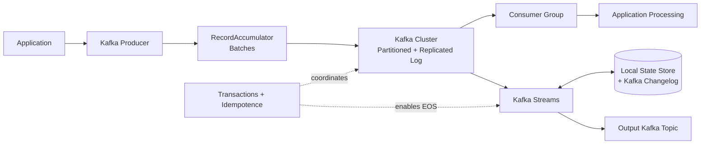

**Kafka's core model:** durable partitioned logs + offsets +
replication.\
**Producer performance:** asynchronous batching.\
**Consumer scalability:** partition assignment across a consumer group.\
**Reliability:** acknowledgements, retries, replication and
idempotence.\
**Atomic Kafka workflows:** transactions.\
**Stateful event processing:** Kafka Streams with state stores and
changelogs.\
**Exactly-once:** an *as-if-once committed Kafka result*, not a magical
guarantee for every external side effect.


---

# Part II — Advanced Kafka Concepts

This section builds on the fundamentals above and connects the individual Kafka concepts into a production-level mental model.

## 18. Kafka Architecture — The Big Picture

A Kafka cluster contains **brokers**. Topics are divided into **partitions**, and each partition is hosted by one or more brokers depending on the replication factor.

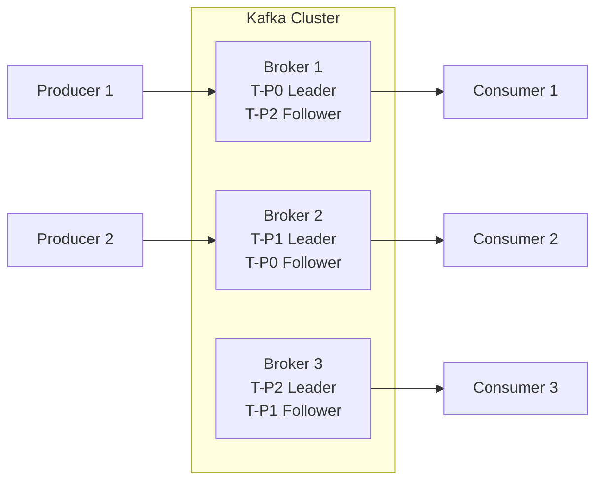

The most important distinction is:

```text
Topic = logical stream/category

Topic
 ├── Partition 0 = ordered append-only log
 ├── Partition 1 = ordered append-only log
 └── Partition 2 = ordered append-only log
```

A topic itself is **not globally ordered**. Ordering exists independently inside each partition.

---

## 19. What Actually Happens During `producer.send()`

A useful end-to-end mental model is:

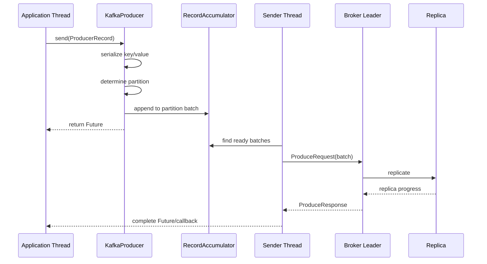

This explains why `send()` is normally fast: the application thread usually places the record into producer-managed memory rather than waiting for the network round trip.

### `buffer.memory`

`buffer.memory` controls the approximate total memory the producer can use for buffering records waiting to be sent.

If the producer generates records faster than brokers/network can accept them:

```text
Application
    ↓ very fast
Producer Buffer
████████████████  FULL
    ↓ slower
Broker
```

`send()` may block waiting for buffer space, subject to `max.block.ms`, and can eventually fail if space/metadata cannot become available.

### `batch.size` versus `linger.ms`

These settings work together:

```text
batch.size
    → how large a per-partition batch should ideally be allowed to grow

linger.ms
    → how long the producer may intentionally wait for more records
      before sending an otherwise sendable batch
```

Larger batches generally improve throughput and compression, but additional waiting can increase latency.

---

## 20. Kafka Record Batches

A network produce request can contain batches for multiple partitions.

Conceptually:

```text
ProduceRequest
│
├── Topic A
│   ├── Partition 0 -> RecordBatch [M1 M2 M3]
│   └── Partition 1 -> RecordBatch [M4 M5]
│
└── Topic B
    └── Partition 2 -> RecordBatch [M6 M7 M8]
```

The **batch is not one Kafka message**. Individual records still receive individual offsets in their partition.

For example:

```text
Partition 0

Batch
┌──────────────────────────────┐
│ M1       M2       M3         │
│ off=100  off=101  off=102    │
└──────────────────────────────┘
```

Batching is a transport/storage optimization; it does not collapse all records into a single logical record.

---

## 21. Compression and Batching

Kafka can compress producer batches using codecs such as gzip, Snappy, LZ4 or Zstandard depending on configuration/support.

```text
M1 + M2 + M3 + M4
        ↓
     batching
        ↓
┌───────────────────┐
│ Record Batch      │
└───────────────────┘
        ↓
    compression
        ↓
smaller network payload
```

Compression is especially effective because similar records are compressed together as a batch.

This is another reason good batching can improve throughput.

---

## 22. Partition Leaders, Followers and ISR

For a replicated partition:

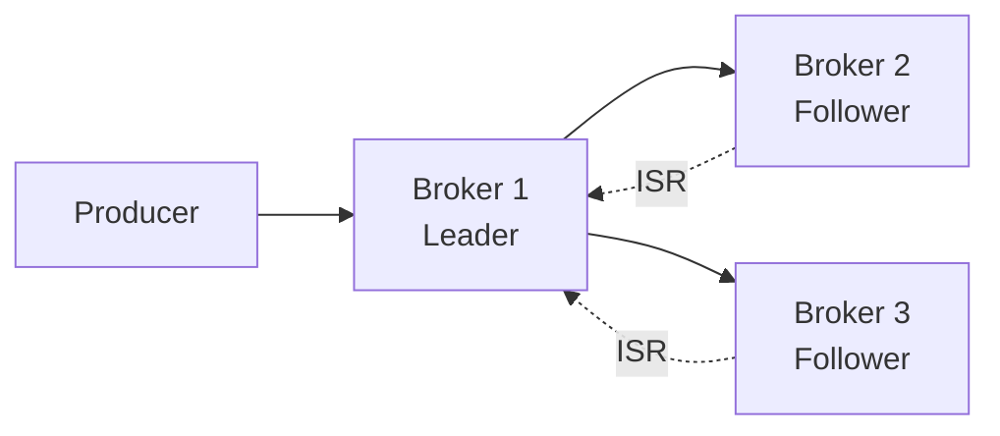

Producers and consumers normally communicate with the **leader** for a partition. Followers replicate the leader's log.

### ISR — In-Sync Replicas

ISR is the set of replicas sufficiently caught up with the leader according to Kafka's replication rules.

Suppose:

```text
Replication factor = 3

Broker 1 = Leader
Broker 2 = In Sync
Broker 3 = badly behind

ISR = {Broker1, Broker2}
```

The third replica still exists but is not currently in the ISR.

### `min.insync.replicas`

Suppose:

```properties
replication.factor=3
min.insync.replicas=2
acks=all
```

Kafka requires enough in-sync replicas for the write to satisfy the configured durability rule.

This combination is commonly used for stronger durability.

---

## 23. High Watermark and Log End Offset

Two positions are useful for understanding replication:

```text
Leader log

0 1 2 3 4 5 6 7 8 9
─────────────────────►
            ↑       ↑
           HW      LEO
```

**LEO (Log End Offset)** represents the end of a replica's log.

**High Watermark (HW)** represents the boundary up to which records are considered replicated/available according to Kafka's replication progress.

This distinction prevents consumers from simply reading arbitrary leader records that could disappear during a leader failure.

---

## 24. Producer Idempotence — Internals

The idempotent producer is easier to understand using two values:

```text
PID      = Producer ID
Sequence = monotonically tracked sequence per partition
```

Example:

```text
Producer
PID = 900

Partition P0:
M1 -> sequence 0
M2 -> sequence 1
M3 -> sequence 2
```

Broker remembers sequence progress.

If an ACK is lost:

```text
Producer                        Broker

M3 (PID=900, seq=2) ----------> stored
                   <----------- ACK lost

M3 (PID=900, seq=2) ----------> retry

Broker recognizes:
"sequence 2 was already accepted"

→ duplicate append is prevented
```

This solves duplicates caused by retry ambiguity.

It does **not** automatically deduplicate two independent application calls intentionally sending the same business event.

---

## 25. Ordering and `max.in.flight.requests.per.connection`

Imagine batches:

```text
Batch A → M1 M2 M3
Batch B → M4 M5 M6
```

Multiple produce requests can be in flight concurrently.

Modern Kafka's idempotent producer protocol can preserve ordering while allowing multiple in-flight requests within supported limits because sequence numbers let the broker reason about ordering and duplicates.

This is why the old advice:

```properties
max.in.flight.requests.per.connection=1
```

should not be blindly applied to every modern Kafka application. It reduces concurrency and throughput and is not generally required simply to use idempotence.

---

## 26. Consumer Fetching Is Also Batched

Just as producers batch writes, consumers fetch multiple records.

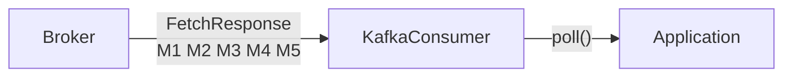

Important settings include:

```text
fetch.min.bytes
fetch.max.bytes
max.partition.fetch.bytes
fetch.max.wait.ms
max.poll.records
```

A useful distinction:

```text
Fetch settings
    → control broker/network fetching

max.poll.records
    → controls how many already-fetched records are returned
      to application code by a poll
```

`max.poll.records` does not directly define the network fetch batch size.

---

## 27. Consumer Group Coordinator

Consumer groups need coordination.

Conceptually:

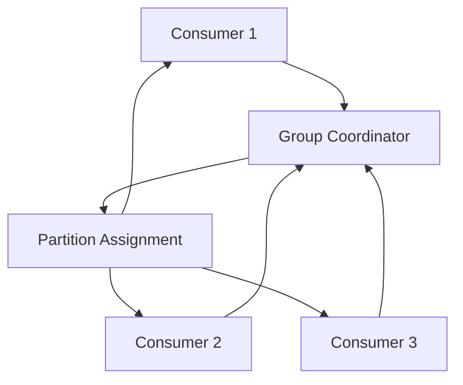

The coordinator manages group membership and participates in the rebalance/assignment protocol.

Committed offsets are stored internally by Kafka, principally in the internal topic:

```text
__consumer_offsets
```

Conceptually:

```text
(group.id, topic, partition) -> committed offset
```

Example:

```text
(payment-service, payments, P0) -> 1050
(payment-service, payments, P1) -> 2077
```

---

## 28. Heartbeats vs `max.poll.interval.ms`

These concepts should not be mixed.

### Heartbeat/session mechanism

Kafka needs to determine whether a group member is alive.

```text
Consumer ---- heartbeat/group protocol ----> Coordinator
```

Session/heartbeat-related settings participate in failure detection.

### Poll-progress mechanism

Kafka separately needs to ensure the application is continuing to call `poll()`.

```properties
max.poll.interval.ms
```

If application processing takes too long between polls, the consumer can lose its group membership/partitions even though the process itself is still running.

Mental model:

```text
Heartbeats/session
      ↓
"Is this consumer/group member alive?"

max.poll.interval.ms
      ↓
"Is the application making poll progress?"
```

---

## 29. Rebalancing

A rebalance can occur when group membership or subscribed partition topology changes, among other coordination events.

Example:

```text
Before

P0 → C1
P1 → C1
P2 → C2
P3 → C2

New C3 joins

          ↓ REBALANCE

After

P0 → C1
P1 → C2
P2 → C3
P3 → one of C1/C2/C3
```

During ownership transitions, applications must be careful with:

- uncommitted work,
- local state,
- in-flight processing,
- offset commits.

### Eager vs cooperative rebalancing

Traditional/eager assignment can revoke broad partition ownership before reassignment.

Cooperative approaches allow partitions to move more incrementally, reducing disruption.

---

## 30. Static Consumer Membership

For relatively stable application instances, `group.instance.id` can provide **static membership**.

Conceptually:

```text
without static membership

temporary restart
    ↓
consumer disappears
    ↓
group membership changes
    ↓
rebalance may occur


with stable group.instance.id

temporary disruption can be handled with
more stable member identity, subject to timeout behavior
```

It can reduce unnecessary partition movement for some deployments.

---

## 31. Offset Reset — `earliest` vs `latest`

`auto.offset.reset` is used when Kafka cannot find a valid committed position for the consumer group/partition.

```properties
auto.offset.reset=earliest
```

Start from the earliest available retained record.

```properties
auto.offset.reset=latest
```

Start from the current end and consume new records going forward.

Important:

> `auto.offset.reset` does **not** override a valid committed offset on every application restart.

---

## 32. At-Most-Once, At-Least-Once and Exactly-Once

### At-most-once

```text
poll
 ↓
commit
 ↓
process
```

Crash after commit but before processing:

```text
message can be lost to application processing
```

### At-least-once

```text
poll
 ↓
process
 ↓
commit
```

Crash after processing but before commit:

```text
message can be processed again
```

### Exactly-once Kafka read-process-write

```text
read Kafka
    ↓
process
    ↓
write Kafka output
+
commit consumed offsets
    ↓
same transaction
```

The final committed Kafka result is consistent as if the input affected the transactional result once.

---

## 33. Transactions — Deeper Mental Model

A transactional producer has a stable transactional identity configured using a `transactional.id`.

Kafka coordinates transaction state through Kafka's transaction-coordination machinery.

```mermaid
flowchart LR
    APP[Application] --> TP[Transactional Producer]
    TP --> TC[Transaction Coordinator]
    TP --> P0["Topic A / P0"]
    TP --> P1["Topic B / P1"]
    TP --> OFF["Consumer Offsets"]

    TC -. coordinates commit/abort .-> P0
    TC -. coordinates commit/abort .-> P1
    TC -. coordinates commit/abort .-> OFF
```

The transaction may include writes to multiple partitions.

Consumers using:

```properties
isolation.level=read_committed
```

see only records belonging to committed transactions.

---

## 34. Transactional Records Can Physically Exist Before Commit

This is an important correction to the simplistic phrase:

> "Either all messages are sent or none are sent."

Records may already be physically appended to Kafka logs while the transaction is still open.

Kafka tracks transaction outcome so `read_committed` consumers expose only the committed view.

Conceptually:

```text
Physical log

M1   M2   M3   ABORT marker
│    │    │
└──── transactional records ────┘

read_uncommitted
    → may observe transactional data before/irrespective of final committed view

read_committed
    → does not expose aborted records as committed application data
```

The atomicity is therefore primarily about **visibility and committed outcome**, not about pretending bytes were never written.

---

## 35. Kafka Streams Architecture

Kafka Streams breaks a topology into processing tasks.

```mermaid
flowchart LR
    P0["Input P0"] --> T0["Task 0"]
    P1["Input P1"] --> T1["Task 1"]
    P2["Input P2"] --> T2["Task 2"]

    T0 --> O0["Output"]
    T1 --> O1["Output"]
    T2 --> O2["Output"]
```

Partitions define the natural unit of parallelism.

If a topic has four partitions, there are four partition-level units of work available for that stage of the topology.

Adding application instances beyond useful task/partition parallelism does not create unlimited extra throughput.

---

## 36. Kafka Streams State Stores

Stateful operations include:

- aggregation,
- count,
- reduce,
- joins,
- windowing,
- deduplication logic,
- per-key device/session state.

A local state store is commonly backed by Kafka using a **changelog topic**.

```mermaid
flowchart LR
    I[Input Topic] --> T[Streams Task]
    T <--> S[("Local State Store")]
    S --> C[("Kafka Changelog Topic")]

    C -. restore after failure .-> S2[("Restored State Store")]
```

If an application instance dies, the task can move to another instance and its state can be reconstructed from the changelog.

This is one of the biggest benefits Kafka Streams provides over manually building state management around the raw Consumer API.

---

## 37. Repartition Topics

Suppose input records are keyed by `orderId`, but you want to aggregate by `customerId`.

```text
Input key = orderId
        ↓
selectKey(customerId)
        ↓
groupByKey()
```

Records for the same `customerId` may currently be spread across different partitions.

Kafka Streams therefore may need an internal **repartition topic**:

```mermaid
flowchart LR
    IN["Input<br/>key=orderId"] --> RK["Re-key<br/>key=customerId"]
    RK --> RP[("Internal Repartition Topic")]
    RP --> AG["Aggregate by customerId"]
```

This ensures all records for a given aggregation key reach the same processing task.

Repartitioning is powerful but adds network, storage and processing overhead.

---

## 38. Changelog vs Repartition Topic

These are frequently confused.

| Internal topic | Purpose |
|---|---|
| **Repartition topic** | Redistributes records according to a new key before downstream processing. |
| **Changelog topic** | Backs up local state so state stores can be restored. |

Mental model:

```text
Repartition
    → "Where should this record be processed?"

Changelog
    → "How can this processing state be recovered?"
```

---

## 39. Windowing

Streams often process events over time windows.

Examples:

```text
Count transactions per customer every 5 minutes
Average sensor temperature over 1 minute
Detect 10 failed logins within 30 seconds
```

Conceptually:

```text
Timeline
──────────────────────────────────────────>

|---- Window 1 ----|
        |---- Window 2 ----|
                |---- Window 3 ----|
```

Kafka Streams supports windowing models for time-based aggregations and joins. The exact semantics depend on the window type and topology.

---

## 40. Event Time, Processing Time and Late Events

Distributed events can arrive late or out of order.

Example:

```text
actual event timestamps:

M1 = 10:00:01
M2 = 10:00:02
M3 = 10:00:03

arrival:

M1
M3
M2   ← late/out of order
```

A robust streaming design must distinguish the record/event timestamp from the time the application happens to process it.

Windowing and grace behavior help determine how late-arriving events affect previously formed windows/results.

---

## 41. Kafka Streams Exactly-Once v2

Configure:

```properties
processing.guarantee=exactly_once_v2
```

Conceptually Kafka Streams coordinates:

```text
Input offsets
      +
State-store/changelog updates
      +
Output topic records
      ↓
Kafka transaction
```

If processing fails before the transaction commits:

```text
transaction aborted
      ↓
read_committed downstream does not observe partial committed output
      ↓
input can be processed again
```

Thus:

```text
physical execution:
may happen more than once

committed Kafka-visible effect:
as if once
```

That distinction is fundamental.

---

## 42. Exactly Once Does Not Automatically Extend to a Database

Consider:

```text
Kafka input
    ↓
Consumer
    ↓
UPDATE Oracle
    ↓
commit Kafka offset
```

Failure after the Oracle commit but before Kafka offset commit can cause:

```text
Oracle updated
Kafka offset not committed
        ↓
record replayed
        ↓
Oracle update may happen again
```

Kafka cannot automatically make an unrelated database transaction atomic with a Kafka transaction.

Common solutions include:

- idempotent database operations,
- unique business/event IDs,
- transactional outbox,
- inbox/deduplication tables,
- CDC,
- carefully designed business semantics.

---

## 43. Transactional Outbox Pattern

A common microservice pattern is:

```mermaid
flowchart LR
    S[Service] --> DB[(Business Tables)]
    S --> O[(Outbox Table)]
    DB -. same DB transaction .- O
    O --> CDC[CDC / Connector]
    CDC --> K[(Kafka)]
```

The service atomically commits:

```text
business state
+
outbox event
```

in one database transaction.

A CDC/outbox publisher then publishes the event to Kafka.

This avoids the dangerous dual-write pattern:

```text
commit DB
then
publish Kafka
```

where a crash between the two operations can leave the systems inconsistent.

---

## 44. Consumer Idempotency

At-least-once delivery means business code should often tolerate duplicates.

One pattern is:

```text
message eventId = ABC123

Consumer
   ↓
Has ABC123 already been processed?
   ├── YES → ignore/reuse previous result
   └── NO  → perform operation + record ABC123
```

The deduplication marker and business update should ideally be committed atomically in the same database transaction when applicable.

---

## 45. Poison Pills and Deserialization Failures

A malformed record may fail before ordinary business processing.

```text
Kafka bytes
    ↓
Deserializer
    ↓
Java object
```

If deserialization fails:

```text
Kafka bytes
    ↓
Deserializer  X
    ↓
listener never receives normal domain object
```

Frameworks such as Spring Kafka provide mechanisms such as error-handling deserializers, error handlers and dead-letter publishing strategies to deal with such records.

A DLQ/DLT is useful when a record cannot be successfully processed after the application's chosen recovery policy.

---

## 46. Retry Topics vs Immediate Retry

Not all failures should be retried immediately.

```text
Transient DB failure
    → short retry may work

Downstream outage for 30 minutes
    → tight retry loop can make things worse
```

A retry-topic strategy can be conceptualized as:

```mermaid
flowchart LR
    M[Main Topic] --> C[Consumer]
    C -->|success| OK[Done]
    C -->|temporary failure| R1["Retry Topic<br/>delay"]
    R1 --> C2[Retry Consumer]
    C2 -->|still fails| DLT[Dead Letter Topic]
```

This separates retry timing from the main consumer loop and prevents one problematic record from unnecessarily blocking all useful processing, depending on ordering requirements.

---

## 47. Backpressure — Kafka's Practical Model

Kafka Consumer is pull-oriented:

```text
Broker
   ↑
 consumer.poll()
   |
Application controls when it asks for more
```

But calling `poll()` is also part of group liveness/progress, so simply stopping polls for a long time is not always safe.

Applications control load using combinations of:

- `max.poll.records`,
- pause/resume,
- worker/concurrency design,
- partitioning,
- processing capacity,
- appropriate `max.poll.interval.ms`.

When parallelizing records after a poll, offset management becomes more complex because completion may occur out of order.

---

## 48. Partition Count Is an Architectural Decision

Partitions affect:

```text
throughput
parallelism
ordering
consumer scalability
broker metadata/resources
rebalance behavior
stateful stream tasks
```

Example:

```text
Topic partitions = 3
Consumer group consumers = 10

Only up to 3 consumers can actively own those
3 partitions at a time for that topic assignment.
```

Increasing partition count can increase parallelism, but it is not free.

### Important key-ordering consequence

If the number of partitions changes, hash-based key-to-partition mapping may change.

Therefore:

```text
same key
+
partition count changed
=
not guaranteed to map to its old partition
```

This matters when reasoning about historical ordering and partition-local state.

---

## 49. Hot Partitions

Good total partition count does not guarantee balanced load.

Suppose:

```text
key = customerId

Customer A = 60% of all traffic
```

If all Customer A records map to one partition:

```text
P0 ████████████████████
P1 ███
P2 ██
P3 ███
```

P0 becomes a **hot partition**.

Solutions depend on whether strict per-key ordering/state is required. Sometimes the key can be redesigned or sharded; sometimes the business requirement means the hotspot must be handled rather than arbitrarily spreading the key.

---

## 50. Retention vs Compaction

### Delete retention

```text
M1 M2 M3 M4 M5 M6
         ↑
older segments eventually deleted
```

Useful for event histories with a bounded retention horizon.

### Log compaction

Suppose:

```text
K1=A
K2=X
K1=B
K1=C
K2=Y
```

Compaction eventually aims to retain the latest state per key, conceptually:

```text
K1=C
K2=Y
```

Compaction is useful for changelogs and state-like topics.

It is asynchronous; do not assume older values disappear immediately.

---

## 51. Tombstone Records

For compacted topics, a record with a key and null value is commonly called a **tombstone**.

```text
key=customer123
value=null
```

It represents a deletion for that key in compacted-log semantics.

This is heavily used in Kafka Streams state/changelog and CDC-style architectures.

---

## 52. Schema Evolution

Kafka stores bytes; producers and consumers must agree on how those bytes are interpreted.

Common serialization formats include:

```text
JSON
Avro
Protocol Buffers
JSON Schema
custom binary formats
```

Production systems often use a schema registry to manage compatible schema evolution.

Example evolution:

```text
V1
{
  customerId,
  name
}

V2
{
  customerId,
  name,
  email
}
```

Compatibility strategy matters because old and new producers/consumers can coexist during deployments.

---

## 53. Consumer Lag

Consumer lag approximately measures how far a consumer group is behind the available log position.

```text
Latest relevant partition position = 10,000
Consumer committed position        =  9,200

lag ≈ 800 records
```

Large lag may indicate:

- consumer processing is too slow,
- downstream dependency is slow,
- insufficient useful partition/consumer parallelism,
- consumer failures/rebalances,
- sudden traffic spikes.

Lag is one of the most important Kafka operational metrics, but record-count lag alone does not always equal time delay.

---

## 54. Observability

For producers, monitor concepts such as:

```text
record send rate
request latency
error rate
retry rate
record queue time
buffer availability
batch size
compression effectiveness
```

For consumers:

```text
records consumed
consumer lag
poll behavior
fetch latency
commit failures
rebalance activity
processing latency
```

For brokers:

```text
under-replicated/offline partitions
ISR changes
request latency
disk/network utilization
controller health
partition distribution
```

The exact metric names depend on Kafka/client version and monitoring system.

---

## 55. Graceful Producer Shutdown

Instead of simply terminating:

```java
producer.close();
```

allows the producer to attempt to finish outstanding sends within its close semantics.

Conceptually:

```text
Application shutdown
       ↓
stop accepting new work
       ↓
finish/flush outstanding producer work
       ↓
close producer
```

This reduces avoidable loss of records that are still only in producer memory.

---

## 56. Graceful Consumer Shutdown

A consumer may be blocked in `poll()`.

KafkaConsumer provides `wakeup()` as the standard mechanism to interrupt a polling consumer from another thread.

Conceptually:

```text
Shutdown thread
      |
      | consumer.wakeup()
      ↓
Consumer poll thread
      ↓
WakeupException
      ↓
finally
      ↓
consumer.close()
```

`KafkaConsumer` itself is not generally intended for arbitrary concurrent use across application threads.

---

## 57. Spring Kafka Mapping

For a Spring Boot/Spring Kafka application, the lower-level concepts map approximately like this:

```mermaid
flowchart LR
    APP["@KafkaListener"] --> LC["Listener Container"]
    LC --> KC["KafkaConsumer"]
    KC --> K[(Kafka)]

    APP2["KafkaTemplate"] --> KP["KafkaProducer"]
    KP --> K
```

`KafkaTemplate` wraps producer usage.

`@KafkaListener` is managed by a listener container, which handles polling, listener invocation, offset/ack behavior, error handling and consumer lifecycle according to configuration.

This is why Spring Kafka `AckMode` and native Kafka `enable.auto.commit` should not be treated as the same concept.

---

## 58. Spring Kafka Ack Modes — Mental Model

Common listener-container acknowledgement modes include concepts such as:

```text
RECORD
    → acknowledge/commit according to successful record processing

BATCH
    → boundary is the records returned by a poll/batch

MANUAL
    → listener calls acknowledgment.acknowledge();
       container controls the eventual commit semantics

MANUAL_IMMEDIATE
    → acknowledgement can result in an immediate commit
       when invoked on the consumer thread
```

Exact behavior depends on Spring Kafka version/configuration, transactions, error handling and threading.

A strong design rule is:

> Decide first what your business processing boundary is, then choose the acknowledgement mode.

Do not select an AckMode merely because its name sounds safer.

---

## 59. Kafka Security — Production View

Kafka commonly supports:

### Encryption

```text
TLS
```

protects data in transit.

### Authentication

Depending on deployment:

```text
mTLS certificates
SASL/SCRAM
SASL/GSSAPI (Kerberos)
SASL/OAUTHBEARER
other supported mechanisms
```

### Authorization

Kafka ACLs or platform-specific authorization mechanisms can control operations such as:

```text
Producer → WRITE topic
Consumer → READ topic
Consumer → READ consumer group
Admin    → CREATE/ALTER resources
```

Authentication answers **who are you?**

Authorization answers **what are you allowed to do?**

---

## 60. KRaft — Modern Kafka Metadata Architecture

Modern Kafka can run using **KRaft**, replacing the historical ZooKeeper dependency for Kafka metadata management.

```mermaid
flowchart TB
    subgraph CQ["KRaft Controller Quorum"]
      C1[Controller 1]
      C2[Controller 2]
      C3[Controller 3]
    end

    CQ --> B1[Broker 1]
    CQ --> B2[Broker 2]
    CQ --> B3[Broker 3]
```

The controller quorum maintains cluster metadata such as topics, partitions and leadership information.

Some small/dev deployments may combine broker and controller roles, while production architecture should be chosen according to Kafka deployment guidance and scale requirements.

---

## 61. End-to-End Production Architecture

Putting the concepts together:

```mermaid
flowchart LR
    API["Spring Boot<br/>Producer Service"] --> KT[KafkaTemplate]
    KT --> K1["Kafka Cluster<br/>replicated partitions"]

    K1 --> CG["Spring Kafka<br/>Consumer Group"]
    CG --> DB[(Database)]

    K1 --> KS["Kafka Streams<br/>Stateful Processing"]
    KS <--> SS[("State Store")]
    SS --> CL[("Changelog")]
    KS --> OUT["Derived Topic"]

    OUT --> DASH[Dashboard / Downstream Service]

    DB2[(Service DB + Outbox)] --> CDC[CDC]
    CDC --> K1
```

A production design should explicitly answer:

1. What is the message key?
2. What ordering is required?
3. How many partitions are needed?
4. What delivery semantic is acceptable?
5. When are offsets committed?
6. How are duplicates handled?
7. What happens if processing crashes?
8. Are external side effects idempotent?
9. Is state local, external, or Kafka Streams-managed?
10. How is state recovered?
11. What is the retention/compaction policy?
12. What replication and ISR durability are required?
13. How are schemas evolved?
14. How are retries and poison records handled?
15. What metrics and lag alerts are required?

---

# 62. Advanced Interview Questions

### Why can Kafka provide high throughput?

Because it combines sequential append-oriented storage, batching, efficient network transfer, partition-level parallelism, page-cache/OS optimizations, compression and asynchronous producer/consumer behavior.

### Does increasing consumers always increase throughput?

No. Within a consumer group, useful parallelism is fundamentally constrained by partition/task ownership and by downstream processing bottlenecks.

### Can two consumers in the same group read the same partition simultaneously?

Not as normal active owners of that partition in the group assignment.

### Can two different consumer groups read the same record?

Yes. Each group maintains independent offsets.

```text
Topic
 ├── Group A → independent position
 └── Group B → independent position
```

### Does committing an offset delete the record?

No.

```text
commit offset
      ≠
delete Kafka record
```

Retention controls record removal.

### Does `acks=all` guarantee zero data loss?

No absolute guarantee. Durability depends on replication, ISR state, `min.insync.replicas`, producer configuration, broker/storage failures and operational design.

### Does idempotence eliminate every duplicate?

No. It protects against duplicate appends caused by producer retry ambiguity. Application-level duplicate business events can still exist.

### Do transactions prevent consumers from ever seeing aborted bytes?

`read_committed` consumers do not expose aborted transactional records as committed application records; physical transactional log data and transaction markers can still exist internally.

### Does exactly-once mean the processing function executes once?

No.

```text
execution attempts ≠ exactly once

committed Kafka-visible result = as-if exactly once
```

### Why is the message key important?

Because it commonly determines partition placement, which affects ordering, load distribution, state locality, joins and aggregations.

---

# 63. Final Advanced Mental Model

```mermaid
flowchart TB
    A[Application Event] --> KEY[Choose Key]
    KEY --> PROD[Producer]

    PROD --> SER[Serialize]
    SER --> PART[Partition]
    PART --> BATCH[RecordAccumulator / Batch]
    BATCH --> LEADER[Partition Leader]

    LEADER --> ISR[In-Sync Replicas]
    ISR --> ACK[ACK]
    ACK --> PROD

    LEADER --> FETCH[Consumer Fetch]
    FETCH --> POLL[poll]
    POLL --> PROC[Business Processing]

    PROC --> COMMIT[Offset Commit]
    PROC --> OUTPUT[Kafka Output]
    PROC --> EXT[External Side Effect]

    OUTPUT --> TX[Kafka Transaction / EOS]
    COMMIT --> TX

    EXT --> IDEMP[Application Idempotency / Outbox]

    LEADER --> STREAM[Kafka Streams]
    STREAM --> STATE[State Store]
    STATE --> CHANGELOG[Changelog Topic]
    STREAM --> REPART[Repartition Topic]
```

The key architectural lesson is that Kafka reliability is **not one configuration property**.

It is the interaction of:

```text
partitioning
+ ordering
+ replication
+ acknowledgements
+ retries
+ idempotence
+ transactions
+ consumer offset strategy
+ state management
+ failure recovery
+ external-system consistency
+ observability
```

Once these interactions are understood, Kafka becomes much easier to reason about than memorizing individual configuration properties.


---

# Part III — Spring Kafka Consumer Failure Handling, Retries and DLT

This section connects native Kafka failure semantics with **Spring for Apache Kafka**. The central idea is that a consumer failure is not solved merely by catching an exception: the application must decide what happens to the **record**, its **offset**, retries, ordering, and eventual recovery.

## 64. Spring Kafka Consumer Processing Model

A typical Spring Kafka flow is:

```mermaid
flowchart LR
    K[(Kafka Topic)] --> C["KafkaConsumer<br/>poll()"]
    C --> LC["Spring Kafka<br/>Listener Container"]
    LC --> L["@KafkaListener"]
    L --> S[Business Service]
    S --> DB[(Database)]

    L -. exception .-> EH["CommonErrorHandler /<br/>DefaultErrorHandler"]
```

Example listener:

```java
@KafkaListener(topics = "orders", groupId = "order-service")
public void consume(OrderEvent event) {
    orderService.process(event);
}
```

Spring's listener container owns the native `KafkaConsumer`, performs `poll()`, invokes the listener, and coordinates offset/acknowledgement and error-handling behavior.

A useful mental model is:

```text
KafkaConsumer.poll()
       ↓
Listener Container
       ↓
Message conversion / listener invocation
       ↓
Business processing
       ↓
Success ───────────────→ offset handling
       │
       └── Exception ──→ error handler
                              ↓
                         retry / recover
                              ↓
                         DLT / skip / stop
```

---

## 65. Two Broad Failure Categories

Consumer failures should first be classified.

### Record-level/business failure

The record was successfully fetched/deserialized, but application processing failed.

Examples:

```text
Database temporarily unavailable
HTTP 503 from downstream service
optimistic-lock failure
business validation exception
```

The listener itself throws the exception:

```java
@KafkaListener(topics = "orders")
public void consume(OrderEvent event) {
    externalService.call(event); // throws exception
}
```

### Deserialization failure

The consumer cannot turn Kafka bytes into the expected Java object.

```text
Kafka bytes
    ↓
JsonDeserializer
    X
Invalid JSON / incompatible payload
```

The ordinary typed listener may never receive a valid domain object.

This distinction is important because **listener exceptions and deserialization exceptions occur at different stages**.

---

## 66. `DefaultErrorHandler`

For modern Spring Kafka applications, `DefaultErrorHandler` is the primary container error handler for many record/batch listener scenarios.

Conceptually:

```mermaid
flowchart TD
    R[Record delivered] --> L[Listener]
    L --> Q{Success?}
    Q -->|Yes| OK[Continue]
    Q -->|No| EH[DefaultErrorHandler]
    EH --> RET{Retry remaining?}
    RET -->|Yes| SEEK["Seek / retry record<br/>according to handler behavior"]
    SEEK --> L
    RET -->|No| REC[Recoverer]
    REC --> DLT[(Dead Letter Topic)]
```

A common configuration is:

```java
@Bean
DefaultErrorHandler kafkaErrorHandler(
        KafkaTemplate<Object, Object> kafkaTemplate) {

    DeadLetterPublishingRecoverer recoverer =
            new DeadLetterPublishingRecoverer(kafkaTemplate);

    FixedBackOff backOff =
            new FixedBackOff(1000L, 2L);

    return new DefaultErrorHandler(recoverer, backOff);
}
```

Interpretation:

```text
initial listener attempt
        ↓ fails
retry after 1 second
        ↓ fails
retry after 1 second
        ↓ fails
recover using DeadLetterPublishingRecoverer
        ↓
publish to DLT
```

With `FixedBackOff(1000, 2)`, the second argument is the number of **retry executions after the initial failed delivery**, so there can be three listener attempts in total.

---

## 67. `DeadLetterPublishingRecoverer`

`DeadLetterPublishingRecoverer` publishes a record that cannot be successfully processed to another Kafka topic.

Default naming commonly maps:

```text
orders
   ↓ failure exhausted
orders.DLT
```

Conceptually:

```mermaid
flowchart LR
    O[(orders)] --> C[Order Consumer]
    C -->|success| DB[(Database)]
    C -->|retryable failure| R[Retry]
    R --> C
    C -->|retries exhausted| D[(orders.DLT)]
```

Example:

```java
@Bean
DeadLetterPublishingRecoverer deadLetterPublishingRecoverer(
        KafkaTemplate<Object, Object> template) {

    return new DeadLetterPublishingRecoverer(template);
}
```

A custom destination resolver can route records differently:

```java
DeadLetterPublishingRecoverer recoverer =
    new DeadLetterPublishingRecoverer(
        kafkaTemplate,
        (record, exception) ->
            new TopicPartition(
                record.topic() + ".DLT",
                record.partition()
            )
    );
```

Preserving the source partition can be useful, but the DLT must have enough partitions for that routing strategy.

---

## 68. Why a DLT Is Useful

A DLT is not simply a place to "hide errors."

It separates records that need investigation or special recovery from the healthy processing path.

```text
Main Topic
   ↓
Consumer
   ├── valid record ──────────→ normal processing
   │
   └── repeatedly failing
              ↓
             DLT
              ↓
       inspect / alert
              ↓
       correct underlying issue
              ↓
       replay if appropriate
```

A good DLT design preserves enough information to diagnose the failure, such as the original topic/partition/offset and exception metadata provided by the framework.

Typical uses:

- poison records,
- permanently invalid business data,
- exhausted transient retries,
- downstream incompatibility,
- manual investigation,
- controlled replay.

---

## 69. Retryable vs Non-Retryable Exceptions

Retrying every exception is usually a mistake.

Suppose:

```text
DatabaseUnavailableException
```

A retry may succeed.

But:

```text
InvalidCustomerIdException
```

retrying the identical record five times is unlikely to help.

Conceptually:

```mermaid
flowchart TD
    E[Listener Exception] --> C{Failure type}
    C -->|Transient| R[Retry with backoff]
    C -->|Permanent| D[Recover / DLT immediately]
    R --> Q{Recovered?}
    Q -->|Yes| OK[Continue]
    Q -->|No| D
```

You can classify exceptions:

```java
DefaultErrorHandler handler =
        new DefaultErrorHandler(
                recoverer,
                new FixedBackOff(1000L, 3L)
        );

handler.addNotRetryableExceptions(
        IllegalArgumentException.class,
        InvalidOrderException.class
);
```

The exact exception hierarchy should reflect your application's failure semantics.

---

## 70. Fixed vs Exponential Backoff

### Fixed backoff

```java
new FixedBackOff(1000L, 3L);
```

Conceptually:

```text
failure
  ↓ 1 sec
retry
  ↓ 1 sec
retry
  ↓ 1 sec
retry
```

Useful for short transient failures.

### Exponential backoff

Conceptually:

```text
failure
  ↓ 1 sec
retry
  ↓ 2 sec
retry
  ↓ 4 sec
retry
  ↓ 8 sec
...
```

This is useful when a downstream dependency may need more time to recover and you want to avoid hammering it.

Choose retry timing based on the dependency and service-level objectives rather than using a large retry count blindly.

---

## 71. Blocking Retry

The `DefaultErrorHandler` pattern is commonly a **blocking/container-level retry** approach.

Conceptually:

```text
Partition P0

M1 → success
M2 → fails
       ↓
      retry
       ↓
      retry
       ↓
      DLT
M3 → only then continue
```

This can preserve partition processing order more naturally, but a bad record can hold up later records from that partition during retries.

That trade-off is important:

```text
stronger ordering behavior
        ↕
partition processing delay
```

---

## 72. Non-Blocking Retry Topics

Spring Kafka also supports retry-topic based processing, commonly configured with `@RetryableTopic`.

Instead of repeatedly retrying on the main listener/container path:

```text
orders
   ↓
consumer fails
   ↓
orders-retry-...
   ↓ delay
retry consumer
   ↓
...
   ↓
orders-dlt
```

Example:

```java
@RetryableTopic(
    attempts = "4",
    backoff = @Backoff(delay = 1000, multiplier = 2.0),
    dltTopicSuffix = "-dlt"
)
@KafkaListener(topics = "orders", groupId = "order-service")
public void consume(OrderEvent event) {
    orderService.process(event);
}
```

Conceptually:

```mermaid
flowchart LR
    M[(orders)] --> C1[Main Listener]
    C1 -->|failure| R1[(orders-retry-0)]
    R1 --> C2[Retry Listener]
    C2 -->|failure| R2[(orders-retry-1)]
    R2 --> C3[Retry Listener]
    C3 -->|exhausted| D[(orders-dlt)]
```

Retry topics free the original consumer path from waiting through long backoff periods.

However, moving failed records to retry topics changes ordering characteristics. Later records from the original partition can progress while the failed record is waiting elsewhere.

Use this when throughput/availability is more important than strict per-partition processing order, or when your business semantics tolerate the resulting reordering.

---

## 73. Blocking Retry vs Retry Topic

| Requirement | Blocking `DefaultErrorHandler` retry | Retry topics / `@RetryableTopic` |
|---|---|---|
| Short transient failure | Excellent fit | Possible but often unnecessary |
| Long delay between attempts | Can tie up partition processing | Better fit |
| Preserve natural partition ordering | Easier | More difficult |
| Avoid blocking main partition | No | Yes |
| Operational complexity | Lower | Higher |
| Separate retry stages/topics | No | Yes |

A useful architecture decision is:

```text
Failure likely clears in milliseconds/seconds
        ↓
blocking retry may be appropriate

Failure may last minutes/hours
        ↓
retry topic is often more appropriate
```

---

## 74. DLT Listener

A DLT can have its own listener:

```java
@KafkaListener(
    topics = "orders.DLT",
    groupId = "order-dlt-handler"
)
public void consumeDlt(ConsumerRecord<String, byte[]> record) {
    // alert, persist for investigation, or invoke controlled recovery
}
```

With retry-topic support, Spring Kafka also provides DLT handling mechanisms such as `@DltHandler` in the corresponding retry-topic model.

Example:

```java
@DltHandler
public void processDltMessage(
        OrderEvent event,
        @Header(KafkaHeaders.RECEIVED_TOPIC) String topic) {

    log.error("Record moved to DLT from {}", topic);
}
```

Do not automatically replay every DLT record forever. A DLT normally represents a record for which the normal recovery policy has already failed.

---

## 75. Deserialization Failure and `ErrorHandlingDeserializer`

Consider:

```java
public class OrderEvent {
    private Long orderId;
    private BigDecimal amount;
}
```

but Kafka contains malformed JSON.

A normal JSON deserializer can fail before the listener receives the record.

Spring Kafka's `ErrorHandlingDeserializer` can capture deserialization failure information so the container/error-handling infrastructure can deal with the failed record rather than allowing a poison payload to repeatedly break normal deserialization.

Typical configuration concept:

```properties
spring.kafka.consumer.key-deserializer=
  org.springframework.kafka.support.serializer.ErrorHandlingDeserializer

spring.kafka.consumer.value-deserializer=
  org.springframework.kafka.support.serializer.ErrorHandlingDeserializer

spring.kafka.consumer.properties.spring.deserializer.key.delegate.class=
  org.apache.kafka.common.serialization.StringDeserializer

spring.kafka.consumer.properties.spring.deserializer.value.delegate.class=
  org.springframework.kafka.support.serializer.JsonDeserializer
```

In YAML:

```yaml
spring:
  kafka:
    consumer:
      key-deserializer: org.springframework.kafka.support.serializer.ErrorHandlingDeserializer
      value-deserializer: org.springframework.kafka.support.serializer.ErrorHandlingDeserializer
      properties:
        spring.deserializer.key.delegate.class: org.apache.kafka.common.serialization.StringDeserializer
        spring.deserializer.value.delegate.class: org.springframework.kafka.support.serializer.JsonDeserializer
```

Additional trusted-package/type configuration may be required depending on how JSON types are configured.

Mental model:

```text
Kafka bytes
    ↓
ErrorHandlingDeserializer
    ↓
delegate JsonDeserializer
    ├── success → OrderEvent → @KafkaListener
    │
    └── failure → failure metadata → container error handling
                                      ↓
                                     DLT
```

---

## 76. Deserialization DLT and Raw Payloads

When deserialization fails, the normal Java domain object does not exist.

Therefore the recovery pipeline may need to publish or inspect the original serialized bytes rather than assuming an `OrderEvent` is available.

This is why producer/template serialization configuration for DLT publishing must be compatible with both:

```text
normal deserialized objects
and
raw data from deserialization failures
```

Spring Kafka provides serializer/error-handler integration patterns for this scenario; configure them deliberately when your DLT must handle poison JSON.

---

## 77. Conversion Failure vs Deserialization Failure

These stages are different:

```text
Kafka bytes
   ↓
Kafka Deserializer
   ↓
ConsumerRecord
   ↓
Spring message conversion
   ↓
@KafkaListener argument
   ↓
Business processing
```

Failures can therefore occur in:

1. Kafka deserialization.
2. Spring message conversion.
3. Listener/business code.
4. Downstream side effects.

Understanding **where** the failure happens determines which error-handling mechanism receives it.

---

## 78. Offset Handling After Recovery

Suppose:

```text
M1 success
M2 permanently fails
M2 published to DLT
M3 success
```

After successful recovery of `M2` to the DLT, the consumer generally needs to progress beyond `M2`; otherwise the poison record would be fetched repeatedly forever.

Conceptually:

```text
M2 failed
   ↓
recoverer successfully publishes M2 to DLT
   ↓
offset/recovery semantics allow source consumer to progress
```

Exactly when/how offsets are committed depends on:

- listener AckMode,
- `DefaultErrorHandler` configuration,
- transactions,
- whether recovery succeeds,
- container mode,
- Spring Kafka version.

This is why DLT publishing and source-offset handling should be treated as one recovery design, not two unrelated settings.

---

## 79. What If DLT Publishing Fails?

A DLT is itself Kafka, so publishing to it can fail.

```text
Main listener fails
      ↓
retries exhausted
      ↓
publish to DLT
      X
Kafka unavailable / authorization failure / serialization failure
```

The system must not silently pretend recovery succeeded.

Production applications should monitor:

```text
DLT publishing errors
error-handler/recoverer failures
producer errors
consumer lag
repeated poison records
```

For stronger atomic Kafka recovery requirements, transactional designs may be appropriate depending on the listener/container architecture.

---

## 80. Spring Kafka Transactions

Spring Kafka can coordinate Kafka producer transactions with listener processing.

Conceptually:

```mermaid
flowchart LR
    IN[(Input Topic)] --> LC[Listener Container]
    LC --> L[@KafkaListener]
    L --> OUT[(Output Topic)]
    L --> OFF[Consumed Offset]

    OUT -. same Kafka transaction .-> TX[Kafka Transaction]
    OFF -.-> TX
```

The goal is:

```text
consume
+
produce Kafka output
+
advance consumed offset
=
one Kafka transactional outcome
```

If processing fails, the Kafka transaction can abort and the input can be redelivered according to the recovery strategy.

This is different from simply setting `enable.auto.commit=false`.

---

## 81. Kafka Transaction Does Not Automatically Include Your Database

Suppose:

```java
@KafkaListener(...)
public void consume(OrderEvent event) {
    repository.save(...);
    kafkaTemplate.send("order-result", ...);
}
```

There are potentially two transaction systems:

```text
Database transaction
Kafka transaction
```

A Kafka transaction alone cannot make an arbitrary database commit part of the same native Kafka transaction.

Architectures that need DB + Kafka consistency should carefully evaluate patterns such as:

```text
transactional outbox
idempotent consumer
CDC
application-specific transaction synchronization
```

Avoid assuming that adding `@Transactional` automatically creates a distributed exactly-once transaction across Kafka and the database.

---

## 82. `AckMode.RECORD`, `BATCH`, `MANUAL`, and `MANUAL_IMMEDIATE`

For record listeners, a simplified mental model is:

### RECORD

```text
poll → M1 M2 M3

M1 listener succeeds → eligible for offset progress
M2 listener succeeds → eligible for offset progress
M3 listener succeeds → eligible for offset progress
```

### BATCH

```text
poll → [M1 M2 M3]

whole poll/listener batch boundary
        ↓
offset handling
```

### MANUAL

```java
public void consume(
        OrderEvent event,
        Acknowledgment acknowledgment) {

    process(event);
    acknowledgment.acknowledge();
}
```

The application explicitly signals acknowledgement, while the container controls commit mechanics according to mode/context.

### MANUAL_IMMEDIATE

Designed for an acknowledgement to be committed immediately when called under the documented consumer-thread conditions.

> Native Kafka `enable.auto.commit` and Spring listener-container AckMode are separate layers. In Spring Kafka applications, use the container's offset-management model deliberately rather than combining settings without understanding which component owns commits.

---

## 83. Failure Timeline — At-Least-Once Spring Kafka Consumer

Consider:

```text
P0:
M1 M2 M3 M4
```

Processing:

```mermaid
sequenceDiagram
    participant K as Kafka
    participant L as @KafkaListener
    participant DB as Database
    participant EH as Error Handler

    K->>L: M1
    L->>DB: process M1
    DB-->>L: success

    K->>L: M2
    L->>DB: process M2
    DB--xL: exception

    L->>EH: throw
    EH->>L: retry M2
    L->>DB: process M2
    DB--xL: exception

    EH->>EH: retries exhausted
    EH->>K: publish M2 to DLT
```

The key question after the DLT succeeds is:

```text
Can the source consumer safely advance beyond M2?
```

Your error-handler, acknowledgement and transaction configuration determines that behavior.

---

## 84. Failure Timeline — Duplicate Database Write

Suppose:

```text
M1 received
   ↓
DB update succeeds
   ↓
application crashes before source offset safely advances
   ↓
M1 redelivered
   ↓
DB update happens again
```

A DLT does not solve this problem because the first attempt technically succeeded in the database.

The database operation itself needs idempotency when duplicate delivery is possible.

Example:

```text
eventId = 98a7...

DB transaction:

IF eventId not already processed:
    apply business update
    insert processed_event(eventId)
ELSE:
    ignore duplicate
```

This is one of the most important distinctions between **Kafka delivery guarantees** and **business exactly-once behavior**.

---

## 85. Suggested Production Failure Strategy

A robust design often looks like:

```mermaid
flowchart TD
    K[(Main Topic)] --> L[@KafkaListener]
    L --> V{Valid payload?}

    V -->|No| DLT[(DLT)]
    V -->|Yes| B[Business Processing]

    B --> R{Result}
    R -->|Success| C[Advance offset]
    R -->|Transient failure| RET[Limited retry + backoff]
    RET --> B
    R -->|Permanent failure| DLT
    RET -->|Retries exhausted| DLT

    DLT --> OBS[Alert / Dashboard]
    OBS --> FIX[Investigate / Correct]
    FIX --> REP[Controlled Replay]
```

Recommended principles:

- Keep retries **bounded**.
- Classify transient versus permanent failures.
- Do not retry malformed/permanently invalid records endlessly.
- Make business operations idempotent where duplicate delivery is possible.
- Preserve original record metadata in the DLT.
- Alert on DLT arrival rather than treating it as success and forgetting it.
- Replay only after understanding why the record failed.
- Monitor consumer lag and retry/DLT volume.
- Decide explicitly whether ordering can be relaxed.
- Test broker, database, deserialization and application-crash failure paths.

---

## 86. Example Spring Boot Configuration

A representative starting point:

```yaml
spring:
  kafka:
    consumer:
      group-id: order-service
      enable-auto-commit: false
      auto-offset-reset: earliest
      key-deserializer: org.springframework.kafka.support.serializer.ErrorHandlingDeserializer
      value-deserializer: org.springframework.kafka.support.serializer.ErrorHandlingDeserializer
      properties:
        spring.deserializer.key.delegate.class: org.apache.kafka.common.serialization.StringDeserializer
        spring.deserializer.value.delegate.class: org.springframework.kafka.support.serializer.JsonDeserializer
        spring.json.trusted.packages: "com.example.events"

    producer:
      key-serializer: org.apache.kafka.common.serialization.StringSerializer
      value-serializer: org.springframework.kafka.support.serializer.JsonSerializer

    listener:
      ack-mode: record
```

Then configure recovery explicitly:

```java
@Configuration
class KafkaConsumerConfiguration {

    @Bean
    DefaultErrorHandler kafkaErrorHandler(
            KafkaTemplate<Object, Object> template) {

        DeadLetterPublishingRecoverer recoverer =
                new DeadLetterPublishingRecoverer(template);

        FixedBackOff backOff =
                new FixedBackOff(1_000L, 2L);

        DefaultErrorHandler handler =
                new DefaultErrorHandler(recoverer, backOff);

        handler.addNotRetryableExceptions(
                IllegalArgumentException.class
        );

        return handler;
    }
}
```

Treat this as a conceptual template; serializer types, exception classification, transaction settings, topic provisioning and framework-version details should be adapted to the application.

---

## 87. Failure-Handling Decision Tree

```mermaid
flowchart TD
    F[Consumer failed] --> D{Deserialization failure?}

    D -->|Yes| ED["ErrorHandlingDeserializer<br/>+ recovery"]
    ED --> DLT[(DLT)]

    D -->|No| T{Transient?}

    T -->|Yes| S{Short retry acceptable?}
    S -->|Yes| DEH["DefaultErrorHandler<br/>blocking backoff"]
    S -->|No| RT["@RetryableTopic<br/>non-blocking retry"]

    DEH --> X{Eventually succeeds?}
    RT --> X

    X -->|Yes| OK[Continue]
    X -->|No| DLT

    T -->|No| DLT

    DLT --> A[Alert / investigate]
    A --> R[Controlled replay]
```

---

## 88. Spring Kafka Interview Questions

### Does the listener receive malformed JSON?

Normally not as a successfully deserialized domain object. Deserialization occurs before ordinary typed listener invocation. `ErrorHandlingDeserializer` allows Spring Kafka's error-handling infrastructure to deal with such failures.

### Is `DefaultErrorHandler` the same as `ErrorHandlingDeserializer`?

No.

```text
ErrorHandlingDeserializer
    → deals with deserialization-stage failures

DefaultErrorHandler
    → container/listener failure recovery policy,
      retries, seeking/recovery, recoverer invocation
```

They can work together.

### Is DLT the first step after a failure?

Usually not for a transient error. A common policy is:

```text
failure
 ↓
limited retry
 ↓
recovery exhausted
 ↓
DLT
```

Permanent/non-retryable failures can go directly to recovery/DLT.

### Does publishing to DLT automatically make processing exactly once?

No. DLT is a recovery mechanism, not an exactly-once guarantee.

### Should all exceptions be retried?

No. Retry only failures that have a reasonable chance of succeeding later.

### What is the downside of blocking retry?

Later records on the affected partition can be delayed while the failed record is retried.

### What is the downside of retry topics?

They add topics/operational complexity and can relax the original partition processing order.

### What happens if the consumer crashes after DB update but before offset commit?

The record can be redelivered and the DB operation can happen again unless the business operation is idempotent.

### Should DLT messages be automatically replayed?

Not blindly. Diagnose and correct the cause first; otherwise replay can simply recreate the same failure loop.

---

## 89. Spring Kafka Consumer Failure Mental Model

```text
                           Kafka Record
                                │
                                ▼
                     ┌─────────────────────┐
                     │ Kafka Deserializer  │
                     └──────────┬──────────┘
                                │
                  malformed ────┼──── valid
                      │         │
                      ▼         ▼
          ErrorHandlingDeserializer
                      │    Listener Container
                      │         │
                      │         ▼
                      │   @KafkaListener
                      │         │
                      │    ┌────┴─────┐
                      │ success     exception
                      │    │           │
                      │    │           ▼
                      │    │   DefaultErrorHandler
                      │    │           │
                      │    │      ┌────┴────┐
                      │    │    retry    recover
                      │    │      │          │
                      │    │      └────┐     ▼
                      │    │           │    DLT
                      │    │           │
                      │    ▼           │
                      │ offset         │
                      │ progress       │
                      │                │
                      └──────────────► DLT

DLT
 │
 ├── alert
 ├── inspect exception + original metadata
 ├── correct cause/data
 └── controlled replay
```

The production-level lesson is:

**Retries handle recoverable failures.  
DLTs isolate unrecoverable records.  
Offset strategy controls redelivery.  
Idempotency protects business side effects.  
Transactions coordinate Kafka read-process-write workflows.**

None of these mechanisms replaces the others.
