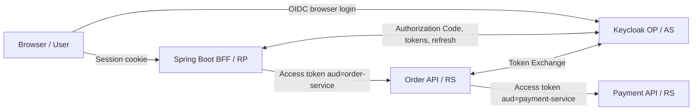
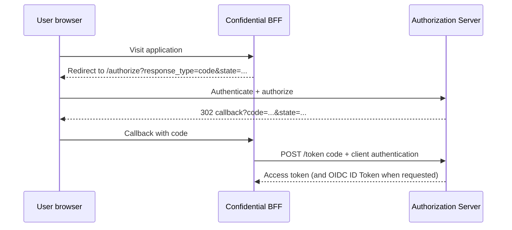
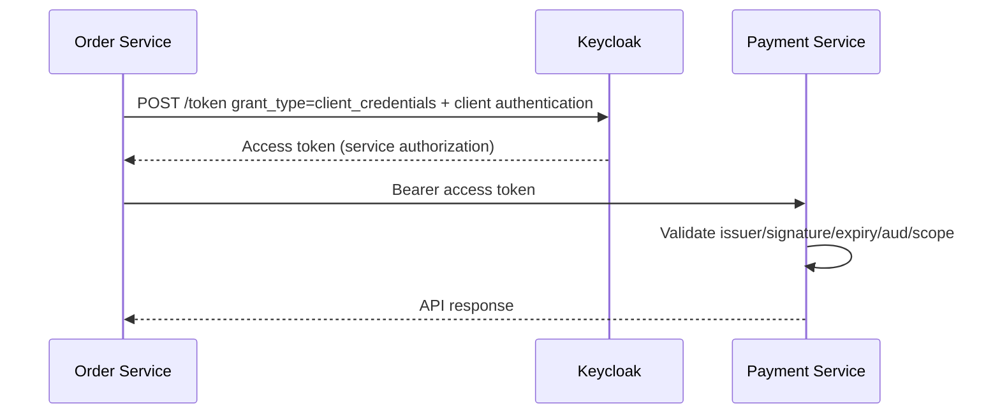
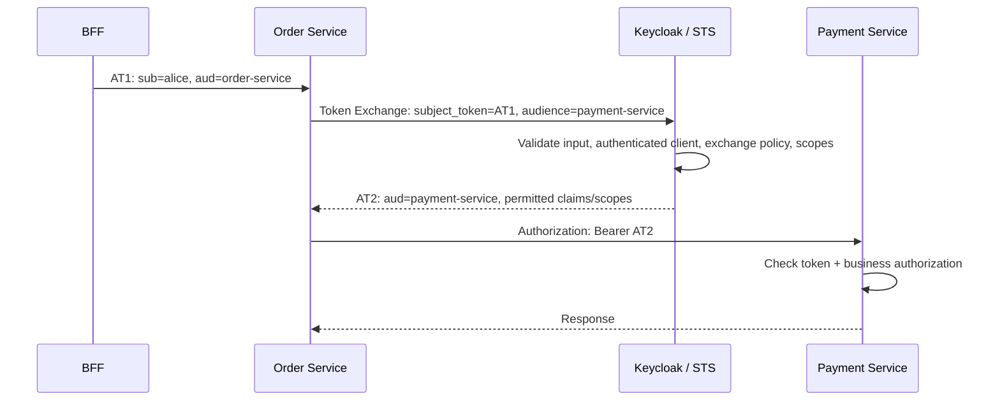
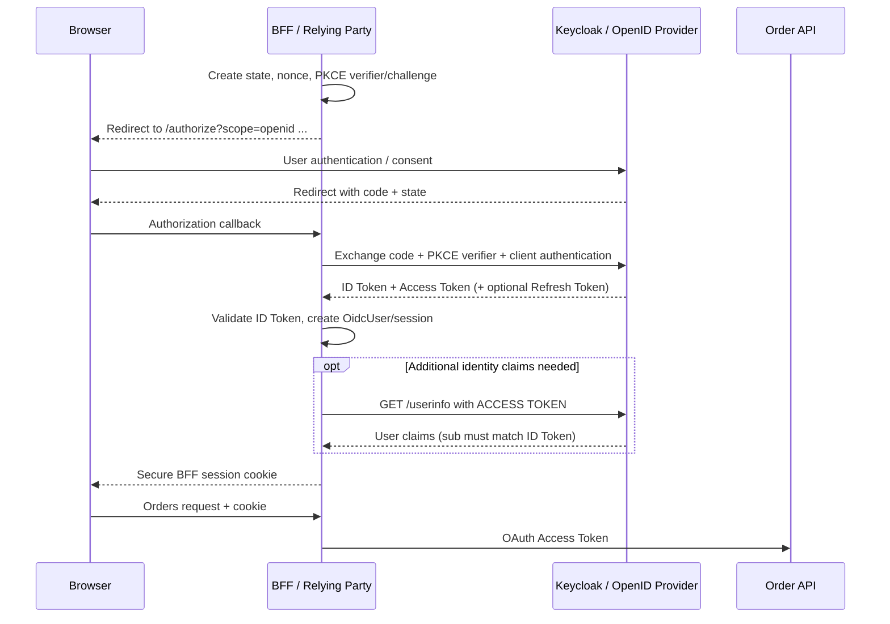
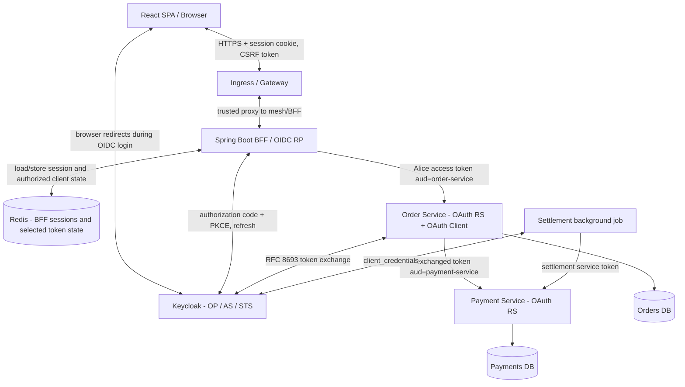
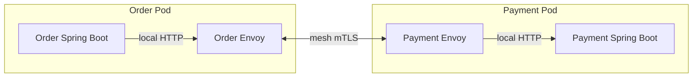
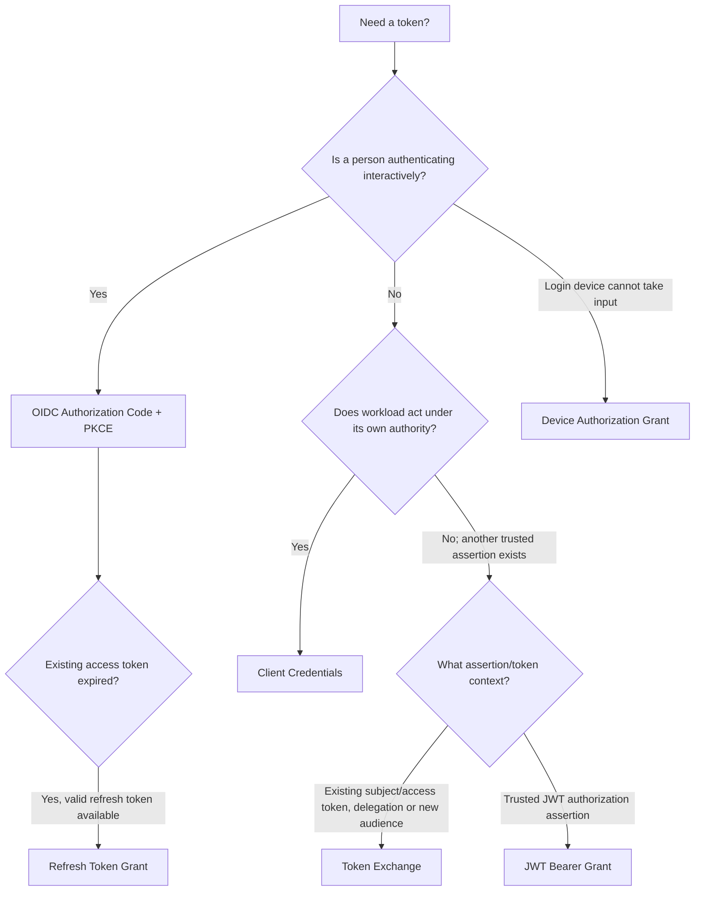

# OAuth 2.0, OpenID Connect, JWT, and Spring Security — Complete Reference

> **Scope:** A consolidated reference from our discussion: all principal OAuth grants; Authorization Code with/without PKCE; OIDC identity; JWT, ID tokens, and access tokens; Spring Security internals; React + Spring Boot BFF + Keycloak + Redis; downstream Token Exchange; Kubernetes/Envoy sidecar mTLS; scaling, failure modes, and security controls.
>
> **Audience:** Senior Java/Spring Boot engineers and system architects. Examples are illustrative and use fictional domains, claims, IDs, and secrets. Adapt them to your Spring Security version, identity provider, and threat model.
>
> **Core mental model:** An **OAuth grant** specifies *how a client obtains authorization to receive a token*; **client authentication** identifies the requesting client; **OIDC** proves *user authentication* to a client; an **access token** carries *API authorization*; a **JWT** is a *token format*; a **browser session** keeps the application's login; **mTLS** protects and authenticates the transport peers.

---

## Table of contents

1. [Big picture and vocabulary](#1-big-picture-and-vocabulary)
2. [OAuth roles and trust boundaries](#2-oauth-roles-and-trust-boundaries)
3. [Grant-type comparison](#3-grant-type-comparison)
4. [Authorization Code without PKCE](#4-authorization-code-without-pkce)
5. [Authorization Code with PKCE](#5-authorization-code-with-pkce)
6. [PKCE threat model, limitations, and client secret](#6-pkce-threat-model-limitations-and-client-secret)
7. [Client Credentials Grant](#7-client-credentials-grant)
8. [Refresh Token Grant and rotation](#8-refresh-token-grant-and-rotation)
9. [Device Authorization Grant](#9-device-authorization-grant)
10. [Token Exchange Grant](#10-token-exchange-grant)
11. [JWT Bearer Grant vs `private_key_jwt`](#11-jwt-bearer-grant-vs-private_key_jwt)
12. [Legacy Implicit and Password grants](#12-legacy-implicit-and-password-grants)
13. [OIDC deep dive](#13-oidc-deep-dive)
14. [ID Token vs Access Token vs Refresh Token](#14-id-token-vs-access-token-vs-refresh-token)
15. [JWT, JWS, JWE, JWK, JWKS, and opaque tokens](#15-jwt-jws-jwe-jwk-jwks-and-opaque-tokens)
16. [Complete React–BFF–Order–Payment architecture](#16-complete-reactbfforderpayment-architecture)
17. [Spring Boot configuration and code](#17-spring-boot-configuration-and-code)
18. [Spring Security inbound and outbound internals](#18-spring-security-inbound-and-outbound-internals)
19. [Redis sessions, caching, and refresh concurrency](#19-redis-sessions-caching-and-refresh-concurrency)
20. [Envoy/Istio sidecar mTLS vs OAuth](#20-envoyistio-sidecar-mtls-vs-oauth)
21. [Failures, retries, auditing, and operations](#21-failures-retries-auditing-and-operations)
22. [Architecture decisions and recommended patterns](#22-architecture-decisions-and-recommended-patterns)
23. [Common misconceptions and interview questions](#23-common-misconceptions-and-interview-questions)
24. [Glossary](#24-glossary)
25. [Specifications and official documentation](#25-specifications-and-official-documentation)

---

## 1. Big picture and vocabulary

| Concept | Category | What question does it answer? | Typical consumer |
|---|---|---|---|
| OAuth 2.0 | Authorization framework | On what basis can a client access resources? | OAuth client + authorization/resource servers |
| OAuth grant type | Protocol flow | How does the client obtain an access token? | OAuth client / authorization server |
| OIDC | Authentication protocol layered on OAuth 2.0 | Who authenticated, and when/how? | Relying Party (OIDC client) |
| Access Token | API authorization credential | May this client access this resource? | Resource Server |
| ID Token | OIDC authentication assertion | What authenticated user does the OP assert? | Relying Party (RP) |
| Refresh Token | Token-renewal credential | May this client obtain more access tokens? | Authorization Server |
| JWT | Claims representation / token format | How are claims encoded and protected? | Depends on the JWT's purpose |
| JWS | Signing / integrity format | Has the signed content been altered? Who signed it? | Token verifier |
| JWKS | Public-key distribution format | Which trusted public key verifies this signature? | Token verifier |
| Client secret / `private_key_jwt` / OAuth mTLS | Client authentication methods | Which registered client is requesting? | Authorization Server |
| PKCE | Authorization Code defense | Does the code redeemer know the verifier for this authorization transaction? | Authorization Server |
| HTTP session / cookie | BFF session mechanism | Is this browser logged into *this application*? | BFF |
| Service-mesh mTLS | Transport/workload security | Who are the TLS peers? Is the channel encrypted? | Sidecar proxies |

### The distinction to remember

```text
GRANT TYPE           How access token is obtained
CLIENT AUTHENTICATION Who the requesting OAuth client is
OIDC ID TOKEN        Authentication assertion to the client/RP
ACCESS TOKEN         Credential presented to a Resource Server
JWT                  One possible representation for those tokens
SESSION COOKIE       Browser -> BFF session continuity
mTLS                 Cryptographic transport protection and peer identity
```

These mechanisms **complement** rather than replace one another.

## 2. OAuth roles and trust boundaries

Four OAuth roles:

1. **Resource Owner:** commonly the user who can authorize data access.
2. **Client:** application requesting access (React SPA, BFF, background job, service).
3. **Authorization Server (AS):** authenticates clients as required, evaluates authorization, and issues tokens (e.g., Keycloak).
4. **Resource Server (RS):** API receiving and validating an access token (e.g., Order Service).

OIDC adds **OpenID Provider (OP)** for identity assertions and calls its client the **Relying Party (RP)**. One Keycloak deployment can serve as both the AS and OP.



**Trust-boundary rules:**
- Browser cookies go to the BFF, not automatically to downstream services.
- ID Tokens belong to the OIDC RP. They are **not** API bearer tokens.
- OAuth access tokens belong to the resource/audience for which they were issued.
- Client secrets, verifier values in a BFF, and refresh tokens should remain server-side.
- mTLS sidecars validate workload identities. They do **not** inherently validate OIDC users or API permissions.

## 3. Grant-type comparison

| Grant type | Main input | Human login? | Normal use | Current direction |
|---|---|---|---|---|
| **Authorization Code + PKCE** | Code + PKCE verifier; confidential clients authenticate | Usually | Web, BFF, SPA, mobile | Recommended |
| **Client Credentials** | Authenticated client's own credentials | No | M2M, scheduled jobs | Recommended |
| **Refresh Token** | Refresh token; confidential client authenticates | No new interaction normally | Renew prior authorization | Recommended under correct policy |
| **Device Authorization** | Device code after user approval elsewhere | Yes, on second device | TV, terminal / limited input | Standard extension (RFC 8628) |
| **Token Exchange** | Subject token, optional actor token | Depends on subject | Audience-restricted downstream calls/delegation | Standard extension (RFC 8693) |
| **JWT Bearer** | Trusted JWT assertion | Not necessarily in this exchange | Trusted assertion integration | Specialized extension (RFC 7523) |
| Implicit | Access token in authorization response | Usually | Historical SPA approach | Discouraged |
| Resource Owner Password Credentials | User's username and password | Direct credential handoff | Historical first-party implementations | **MUST NOT** be used per RFC 9700 |

**PKCE is not a separate grant**; it strengthens Authorization Code. **OIDC is not a grant**; it defines authentication on top of OAuth. **`private_key_jwt` is a client-authentication method**, not a grant.

---

## 4. Authorization Code without PKCE

### Intended path



Authorization request (simplified):

```http
GET /authorize?response_type=code
  &client_id=order-bff
  &redirect_uri=https%3A%2F%2Fapp.example.com%2Fcallback
  &scope=openid%20profile
  &state=RANDOM_CSRF_CORRELATION_VALUE
```

After login, the browser follows the callback:

```http
HTTP/1.1 302 Found
Location: https://app.example.com/callback?code=AUTH_CODE&state=RANDOM_CSRF_CORRELATION_VALUE
```

The BFF exchanges the code with confidential-client authentication:

```http
POST /token HTTP/1.1
Authorization: Basic BASE64(client_id:client_secret)
Content-Type: application/x-www-form-urlencoded

grant_type=authorization_code&code=AUTH_CODE&redirect_uri=https%3A%2F%2Fapp.example.com%2Fcallback
```

**Security considerations:** The AS must enforce code expiry, one-time use, redirect binding, client binding, and appropriate client authentication; the client must verify `state` and protect redirect/callback handling. For a **public client** lacking a secret, intercepted codes create a much bigger redemption risk. Confidential-client authentication helps, but PKCE adds transaction-specific protection even for confidential clients.

## 5. Authorization Code with PKCE

PKCE = **Proof Key for Code Exchange** (RFC 7636).

### The values

- `code_verifier`: fresh, high-entropy random secret per authorization attempt; retained by the initiating OAuth client.
- `code_challenge`: public one-way representation of the verifier.
- `code_challenge_method=S256`: the recommended transformation.

```text
code_challenge = BASE64URL_NO_PADDING(SHA256(ASCII(code_verifier)))
```

### Execution

```mermaid
sequenceDiagram
  participant U as Browser
  participant C as OAuth Client / BFF
  participant AS as Authorization Server
  C->>C: Generate verifier; derive S256 challenge
  C-->>U: Redirect with code_challenge
  U->>AS: GET /authorize ... code_challenge & state
  AS->>AS: Associate challenge with authorization transaction
  AS-->>U: Redirect with authorization code
  U->>C: Callback with code + state
  C->>AS: POST /token code + code_verifier + optional client auth
  AS->>AS: Derive challenge from verifier and compare
  AS-->>C: Access token / ID Token where applicable
```

Authorization request adds:

```http
GET /authorize?response_type=code
  &client_id=order-bff
  &redirect_uri=https%3A%2F%2Fapp.example.com%2Fcallback
  &state=RANDOM_STATE
  &code_challenge=DERIVED_CHALLENGE
  &code_challenge_method=S256
```

Token request adds:

```http
POST /token
Authorization: Basic BASE64(client_id:client_secret)
Content-Type: application/x-www-form-urlencoded

grant_type=authorization_code&code=AUTH_CODE&redirect_uri=https%3A%2F%2Fapp.example.com%2Fcallback&code_verifier=ORIGINAL_VERIFIER
```

A public client (such as an SPA) normally **omits client-secret authentication**. A confidential BFF still **authenticates the client** when exchanging the code.

**Benefit:** Even if the browser-facing authorization code leaks, a party lacking the matching verifier cannot redeem it. The server associates the challenge with that *particular authorization transaction*.

## 6. PKCE threat model, limitations, and client secret

### Is a client secret used with PKCE?

**It can be.** PKCE and client authentication serve different purposes.

| Client architecture | Public/confidential | Client secret? | PKCE? |
|---|---|---|---|
| React SPA implementing OAuth directly | Public | Cannot safely hold one | Required |
| Native mobile app | Public | Cannot safely hold one | Required |
| Spring Boot BFF handling OAuth | Confidential | Usually yes; alternatives include `private_key_jwt` or OAuth mTLS | Recommended |
| Spring Boot backend with Authorization Code | Confidential | Commonly yes | Recommended |
| Backend using Client Credentials | Confidential | One possible auth method | Not applicable to this grant |

A `client_secret` typically identifies/authenticates the *client registration* (a longer-lived credential); a `code_verifier` proves continuity of *one authorization transaction* (fresh each time).

### Can attackers steal the challenge or verifier?

| Attacker has... | Is PKCE-only code redemption possible? |
|---|---|
| Code challenge | No (challenge is meant to be public) |
| Authorization code | No, if PKCE is correctly enforced |
| Code + challenge | No |
| Verifier alone | No, without the matching live code |
| Code + matching verifier | **Potentially yes**, for a public client; a confidential client additionally requires client authentication |

The challenge intentionally travels through the front channel. The verifier stays with the OAuth client until sent directly to `/token` over HTTPS. A compromised SPA script, browser extension, endpoint, proxy, or logging pipeline **can potentially expose it**. PKCE is *not* protection against total compromise, token theft after issuance, or XSS. Use HTTPS, CSP/XSS defenses, secure callback handling, `state`, secure storage, and server-side BFF patterns where appropriate.

A correctly configured **BFF** keeps its verifier in server-side authorization-request state; React never needs to see it. A public SPA needs to retain a verifier in the browser (e.g., appropriate per-transaction temporary storage), so browser compromise matters more.

**Standards:** RFC 9700 requires PKCE for public clients and recommends it for confidential clients. Do not confuse PKCE with `state` (authorization-request correlation/CSRF) or OIDC `nonce` (ID Token/request binding).

---

## 7. Client Credentials Grant

**Use:** An application acts under its *own* authorization without a human user.



Token request:

```http
POST /token
Authorization: Basic BASE64(order-service:client-secret)
Content-Type: application/x-www-form-urlencoded

grant_type=client_credentials&scope=payments.write
```

Access-token response (illustrative):

```json
{"access_token":"eyJ...","token_type":"Bearer","expires_in":3600,"scope":"payments.write"}
```

The token usually represents `order-service`, not Alice. Actual `sub`, `client_id` and related claim mapping is provider-specific.

- No browser redirect, authorization code, PKCE, or user login.
- Confidential client authentication is required; possible methods include `client_secret_basic`, `private_key_jwt`, and certificate-based methods.
- No refresh token normally: obtain a new token using Client Credentials when the old one expires.
- Cache a usable access token rather than calling `/token` for every API request. Each pod can typically cache its own service token; central caching is an optimization, not a default requirement.
- A service-level token cannot by itself prove which human initiated an operation. Use delegated authorization if downstream APIs need Alice's privileges.

## 8. Refresh Token Grant and rotation

A refresh token lets a client obtain new access tokens using an earlier authorization, normally without another interactive login.

```http
POST /token
Authorization: Basic BASE64(client_id:client_secret)
Content-Type: application/x-www-form-urlencoded

grant_type=refresh_token&refresh_token=RT1
```

The server verifies the refresh token, client binding, revocation/expiry, and policy. It issues a new access token and **may** issue a replacement refresh token. Confidential clients authenticate as required.

### Rotation and replay

```text
Initial RT1
  first refresh:  RT1 -> new AT2 + RT2 ; RT1 invalidated
  next refresh:   RT2 -> new AT3 + RT3 ; RT2 invalidated
  reuse of RT1:  potential token replay -> detection / family revocation per AS policy
```

Rotation lowers the value of a stolen old refresh token, but cannot guarantee that an attacker cannot win a race and redeem a stolen currently valid token first. Public clients issued refresh tokens must use rotation or sender-constraining under RFC 9700.

### Is refresh automatic on expiry?

**Not simply because the wall clock reached `exp`.** In ordinary Spring Security outbound OAuth Client integration, renewal occurs when the authorized-client manager is invoked for a client whose access token is expired or sufficiently close to expiry. A separate scheduler is possible but is not implicit.

```text
10:00 login -> AT1 (15 minutes)
10:15 AT1 expires; no API activity -> nothing necessarily happens
10:45 still idle -> no default background refresh
10:50 API call -> manager invoked -> refresh if possible -> AT2
```

An active HTTP session does **not** guarantee the refresh token remains valid; an unexpired refresh token does **not** make an expired application session valid again.

### Production complication: concurrent refresh

Two BFF pods can read the same expired access token + RT1 from Redis. Pod A refreshes and rotates RT1 to RT2; Pod B tries RT1 and gets `invalid_grant` or triggers family-reuse protection. Solutions: per-session/client coordination, re-read under the lock, atomic write/versioning, and safe failure handling. A shared Redis session alone **does not** serialize refresh.

---

## 9. Device Authorization Grant

**Problem:** Smart TV / CLI / input-constrained client cannot conveniently accept usernames, passwords, or MFA.

```mermaid
sequenceDiagram
  participant TV as Device
  participant AS as Authorization Server
  participant Phone as User phone
  TV->>AS: POST /device_authorization client_id, scope
  AS-->>TV: device_code, user_code, verification_uri, interval
  TV-->>Phone: Display verification URL + user code
  par Approval
    Phone->>AS: Visit verification URL; authenticate; approve
  and Polling
    loop Until approved, denied or expired
      TV->>AS: POST /token grant_type=device_code & device_code
      AS-->>TV: authorization_pending / slow_down
    end
  end
  TV->>AS: Poll after approval
  AS-->>TV: Access token (possibly ID Token for supported OIDC device flow)
```

Example request:

```http
POST /device_authorization
Content-Type: application/x-www-form-urlencoded

client_id=smart-tv&scope=openid%20profile
```

Example server response:

```json
{
  "device_code":"LONG_SECRET_VALUE",
  "user_code":"ABCD-1234",
  "verification_uri":"https://iam.example.com/device",
  "expires_in":600,
  "interval":5
}
```

Poll `/token` using:

```http
POST /token
Content-Type: application/x-www-form-urlencoded

grant_type=urn:ietf:params:oauth:grant-type:device_code&device_code=LONG_SECRET_VALUE&client_id=smart-tv
```

Errors: `authorization_pending` (continue at permitted interval), `slow_down` (increase interval by at least five seconds), `access_denied` (stop), `expired_token` (stop), or successful token response. If `interval` is omitted, RFC 8628 specifies five seconds. Network errors require backing off.

**Security:** An attacker can ask a victim to approve a code for the attacker's device (*device authorization phishing*). Display recognizable application/device details and warn users to approve only codes they initiated.

**OIDC variant:** If the OP supports OIDC device authorization and `openid` is requested, the successful result includes an ID Token along with the access token (refresh token optional). The ID Token is still for the client; the access token still belongs at APIs. The device flow does not use the Authorization Code redirect/PKCE pattern.

**Spring:** Do not assume there is a `OAuth2AuthorizedClientProviderBuilder.deviceCode()` built-in method. Use a suitable provider SDK or implement the RFC 8628 device/polling sequence.

---

## 10. Token Exchange Grant

**Use case:** Alice's token is valid for `order-service`, but Order Service needs an appropriately scoped token for `payment-service`. The recipient should not accept an access token whose `aud` excludes it.



Example:

```http
POST /token
Authorization: Basic BASE64(order-service:client-secret)
Content-Type: application/x-www-form-urlencoded

grant_type=urn:ietf:params:oauth:grant-type:token-exchange
&subject_token=ALICE_ORDER_ACCESS_TOKEN
&subject_token_type=urn:ietf:params:oauth:token-type:access_token
&requested_token_type=urn:ietf:params:oauth:token-type:access_token
&audience=payment-service
&scope=payments.write
```

Illustrative response:

```json
{
  "access_token":"PAYMENT_ACCESS_TOKEN",
  "issued_token_type":"urn:ietf:params:oauth:token-type:access_token",
  "token_type":"Bearer",
  "expires_in":300,
  "scope":"payments.write"
}
```

**Important:** `audience=payment-service` and `scope=payments.write` are *requests*, not automatically granted permissions. The AS must authorize the exchange, the target audience, subject, actor, and requested privileges. In Keycloak, verify client permissions, audience mapping, and downscoping policies; do not assume every exchange only reduces permissions by default.

### Delegation vs impersonation

- **Impersonation-style result:** target receives a token representing `sub=alice` with no explicit actor attribution.
- **Delegation-style result:** target receives a token identifying both `sub=alice` and an actor, e.g. `"act":{"sub":"order-service"}` (if configured/supported).
- `act` (RFC 8693 actor) is **not** the same as a provider-specific `azp` (authorized party) claim.
- An `actor_token` can be part of a token exchange, but an actor claim is not automatically guaranteed by every issuer.

### Forward existing token or exchange it?

If AT1 already includes `payment-service` in its audience, authorizes the operation, and forwarding is permitted by the design, an exchange is **not always technically required**. Exchange is useful for least privilege, separate audience, delegation, and hop-specific authorization. Conversely, a pure backend service operation with no end-user semantics might be better served by Client Credentials.

The original token is **not inherently revoked** by exchange; AT1 and AT2 can remain simultaneously valid. Revocation propagation is issuer-dependent.

### Token Exchange vs Client Credentials

| Question | Client Credentials | Token Exchange |
|---|---|---|
| Whose authority? | Service/client's own | Subject token, plus optional delegated actor |
| Requires Alice's token? | No | Yes, for Alice-based downstream delegation |
| Downstream user context? | Not naturally | Can preserve it |
| Typical use | Settlement job | User-initiated Order → Payment |

---

## 11. JWT Bearer Grant vs `private_key_jwt`

**JWT Bearer Grant (RFC 7523):** A client presents a **trusted JWT assertion as the authorization grant** and asks the AS for an access token.

```http
POST /token
Content-Type: application/x-www-form-urlencoded

grant_type=urn:ietf:params:oauth:grant-type:jwt-bearer
&assertion=SIGNED_JWT_ASSERTION
&scope=payments.read
```

An assertion normally contains `iss`, `sub`, `aud`, and `exp`; the AS verifies signature, issuer trust, audience, time, and policy. Example:

```json
{"iss":"https://identity.example.com","sub":"employee-123","aud":"https://auth.example.com","exp":1795000300,"jti":"assertion-789"}
```

The **assertion is not necessarily the resulting access token**. It is a credential the AS accepts to issue an access token. The way the client acquired that assertion is out of scope for RFC 7523.

**`private_key_jwt` client authentication:** A client signs a JWT to prove **its own identity**, often during an entirely different grant such as Client Credentials.

```http
POST /token
Content-Type: application/x-www-form-urlencoded

grant_type=client_credentials
&client_id=order-service
&client_assertion_type=urn:ietf:params:oauth:client-assertion-type:jwt-bearer
&client_assertion=SIGNED_CLIENT_ASSERTION
```

| | JWT Bearer authorization grant | `private_key_jwt` authentication |
|---|---|---|
| Purpose | Authorization assertion | Authenticate client |
| Form parameter | `assertion` | `client_assertion` |
| Grant type | JWT-bearer URN | Could be `client_credentials`, `authorization_code`, etc. |
| JWT issuer/subject | Depends on trusted assertion issuer/subject | Normally the OAuth client |

**Do not infer the grant from the presence of a JWT.** Read `grant_type`. Also, a JWT access token cannot automatically be used as a valid JWT Bearer assertion; the target AS must explicitly trust and authorize that usage.

---

## 12. Legacy Implicit and Password grants

### Implicit Grant

Historically intended for browser-side clients. It returned an access token in the authorization response (typically the URL fragment):

```text
https://app.example.com/callback#access_token=ACCESS_TOKEN&token_type=Bearer
```

It bypasses an authorization-code token exchange and increases front-channel token exposure risks. **Avoid for new applications; use Authorization Code + PKCE.** RFC 9700 says clients **SHOULD NOT** use Implicit except for narrowly mitigated circumstances.

### Resource Owner Password Credentials (ROPC)

The client collects the user's username/password and passes them to the token endpoint:

```http
POST /token
Content-Type: application/x-www-form-urlencoded

grant_type=password&username=alice&password=PASSWORD
```

This gives the client raw user credentials, complicates MFA/federation/passkeys, and increases phishing/credential-handling risk. **RFC 9700 says this grant MUST NOT be used.** Migrate to interactive login through the trusted OP (Authorization Code + PKCE).

---

## 13. OIDC deep dive

### Why OIDC exists

OAuth access tokens authorize resource access; OAuth alone does **not** define a standardized authentication assertion for the client application. OIDC specifies the **ID Token**, the `openid` scope, issuer discovery, user identity claims, UserInfo, authentication-session concepts, and related rules.

### Standard OIDC Authorization Code flow



Authorization URL includes:

```http
GET /authorize?response_type=code
  &client_id=banking-bff
  &redirect_uri=https%3A%2F%2Fapp.example.com%2Flogin%2Foauth2%2Fcode%2Fkeycloak
  &scope=openid%20profile%20email
  &state=STATE
  &nonce=NONCE
  &code_challenge=CHALLENGE
  &code_challenge_method=S256
```

- `openid`: turns a suitable OAuth request into an OIDC authentication request.
- `profile`, `email`: request claim categories, subject to OP policy.
- `state`: authorization callback correlation and CSRF defense.
- `nonce`: request↔ID Token binding when used; check it when supplied.
- PKCE verifier: required to redeem the authorization code when challenge is used.

### Important OIDC terms

| Term | Meaning |
|---|---|
| End User | Person authenticating |
| RP (Relying Party) | Application trusting OP's authentication assertion |
| OP (OpenID Provider) | Issues ID Token; commonly Keycloak |
| ID Token | Signed JWT with authentication claims |
| UserInfo | Protected endpoint for user claims; accessed with an access token |
| Discovery | Provider metadata via `/.well-known/openid-configuration` |

### ID Token claims

Illustrative payload:

```json
{
  "iss":"https://iam.example.com/realms/banking",
  "sub":"alice-123",
  "aud":"banking-bff",
  "iat":1795000000,
  "exp":1795000300,
  "auth_time":1794999980,
  "nonce":"NONCE",
  "name":"Alice",
  "email":"alice@example.com",
  "email_verified":true,
  "acr":"urn:example:mfa",
  "amr":["pwd","otp"]
}
```

| Claim | Meaning / caveat |
|---|---|
| `iss` | Trusted OP issuer URL |
| `sub` | Subject identifier; generally identify account by `iss` + `sub`, not email |
| `aud` | Relying Party client ID (e.g., `banking-bff`) |
| `exp`, `iat` | Expiry / issuance time |
| `auth_time` | Time of end-user authentication |
| `nonce` | Must match initiating transaction when sent |
| `acr` | Authentication context class; provider-specific semantics |
| `amr` | Authentication methods (e.g., `pwd`, `otp`), interpreted per issuer |
| `azp` | Authorized party claim when applicable; follow OIDC validation rules |

Subject identifiers may be **public** or **pairwise**; `sub` need not have the same value across independent clients. Do not treat email as a permanent unique identity key.

### OIDC ID Token validation

1. Verify accepted JWT algorithms/signature against trusted issuer keys.
2. Validate exact `iss` and client `aud`; handle multiple audiences / `azp` where applicable.
3. Validate `exp`, `iat` and relevant time claims.
4. Validate `nonce` where included in the original request.
5. Apply other flow-specific ID Token rules and configured authentication requirements.
6. Only then establish the user's authenticated principal/session.

A valid signature **alone** proves neither the intended audience nor correct token purpose. If UserInfo is called with an OAuth access token, **compare its `sub` with the validated ID Token's `sub`**.

### Discovery and JWKS

```http
GET https://iam.example.com/realms/banking/.well-known/openid-configuration
```

The metadata supplies `issuer`, `authorization_endpoint`, `token_endpoint`, `userinfo_endpoint`, `jwks_uri`, and supported capabilities. The JWKS URL publishes **public** signing keys (not the private key). Libraries may cache keys and handle rotation.

### Single Sign-On vs session

Alice can authenticate with Keycloak for Application A. When she later visits B, Keycloak may reuse its own OP login session, but Application B still establishes **its own** ID Token verification and application session. Applications do **not** automatically share access tokens or cookies.

Logging out of the BFF does not automatically revoke refresh tokens, terminate the OP SSO session, or sign out every RP. Distinguish local logout, RP-initiated logout, front/back-channel logout, and token revocation.

---

## 14. ID Token vs Access Token vs Refresh Token

| Property | ID Token | Access Token | Refresh Token |
|---|---|---|---|
| Protocol role | OIDC user-authentication assertion | OAuth API authorization credential | Token renewal credential |
| Consumer | OIDC RP (BFF) | Resource Server (Order/Payment API) | Authorization Server `/token` |
| Format | JWT | JWT or opaque | Often opaque; format provider-specific |
| Typical `aud` | OIDC client ID | API audience(s), if token format exposes claims | Internal to AS; not an API audience token |
| Typical content | Identity/authentication claims | Scopes, subject/client, audience, permissions | Credential for subsequent renewal |
| Sent to business API? | **No** | **Yes** | **No** |
| Issued by Client Credentials? | Not for ordinary user OIDC auth | Yes | Normally not |

Example ID Token:

```json
{"iss":"https://iam.example.com","sub":"alice","aud":"banking-bff","nonce":"abc","exp":1795000300}
```

Example JWT Access Token:

```json
{"iss":"https://iam.example.com","sub":"alice","aud":"order-service","scope":"orders.read","exp":1795000900}
```

Both may contain the **same** `sub`; they still have different recipients and trust contracts.

**Never send the ID Token to Order Service just because it contains Alice's identity.** Order Service should require an access token intended for it. Conversely, the BFF should not treat an arbitrary OAuth access token as a substitute for the standard OIDC ID Token login assertion.

### Three independent lifetimes

```text
10:00  ID Token issued, access token issued, BFF session created
10:05  ID Token expires -> DOES NOT automatically log out active BFF session
10:15  Access token expires -> BFF may refresh on next outbound operation
10:30  BFF session times out -> browser must re-establish application session
```

Exact durations are policy-dependent. The mere validity of a refresh token does not resurrect an expired BFF session.

## 15. JWT, JWS, JWE, JWK, JWKS, and opaque tokens

### JWT is not synonymous with access token

A JWT is a claims representation. JWTs can be:

- OAuth JWT **Access Tokens** (API authorization).
- OIDC **ID Tokens** (user authentication result).
- **Client assertions** used with `private_key_jwt`.
- **Authorization assertions** used by the JWT Bearer grant.

A common signed JWT compact representation is:

```text
BASE64URL(JOSE_HEADER).BASE64URL(PAYLOAD).BASE64URL(SIGNATURE)
```

The JOSE header may contain `alg`, `kid`, and a token type indicator `typ`. A JWT *access-token profile* such as RFC 9068 uses `typ: at+jwt` and profile-specific validation rules to reduce JWT-type confusion.

- **JWS**: integrity/authenticity protection by signature or MAC. A JWS payload is not secret merely because it is base64url-encoded.
- **JWE**: encrypted payload; protects confidentiality when configured correctly.
- **JWK**: JSON Web Key; a key representation.
- **JWKS**: JSON Web Key Set; publishes a collection of keys, usually public verification keys.
- **Opaque token**: uninterpretable string for the client/RS; RS commonly uses OAuth token introspection to validate it.

### JWT vs opaque access tokens

| | JWT access token | Opaque access token |
|---|---|---|
| RS validation | Often local signature + claims | Often AS introspection |
| Network dependency | Usually no AS call per request once keys are available | Frequently introspection call / cache |
| Immediate revocation | Requires extra design (short expiry, denylist, etc.) | Often easier to centralize with introspection |
| Visibility of claims | Payload decodable if unencrypted | Not directly visible |

### Validating a JWT access token

In a Spring Resource Server:

1. Parse as an accepted access-token format.
2. Verify signature against trusted issuer's keys/allowed algorithms.
3. Verify `iss`, `exp`, `nbf` and applicable time checks.
4. Verify **intended API audience** `aud` (configure explicitly).
5. Enforce `scope`/permissions and business object-level authorization.
6. If using RFC 9068, enforce appropriate access-token profile/type checks.

Do not use a JWT ID Token as an API credential. Signature validation without audience/purpose checks is insufficient.

---

## 16. Complete React–BFF–Order–Payment architecture

### Logical component map



The service arrows represent logical calls. When the mesh is in **sidecar mode**, in-mesh traffic physically goes through the source and destination Envoy proxies, even though the application code just makes an HTTP call.

### One complete user transaction

```mermaid
sequenceDiagram
  autonumber
  participant U as Alice / React
  participant I as Ingress
  participant B as BFF
  participant R as Redis
  participant K as Keycloak
  participant O as Order Service
  participant P as Payment Service

  U->>I: Open protected application
  I->>B: Request without authenticated session
  B->>R: Save pending OIDC authorization state
  B-->>U: 302 to Keycloak /authorize (state, nonce, PKCE)
  U->>K: Authenticate (possibly MFA)
  K-->>U: 302 callback?code=...&state=...
  U->>I: Browser follows callback
  I->>B: Callback to OAuth2LoginAuthenticationFilter
  B->>R: Retrieve matching authorization request/verifier
  B->>K: Exchange code + PKCE verifier + client auth
  K-->>B: ID Token, Access Token, optional Refresh Token
  B->>B: Validate ID Token; establish authenticated OidcUser
  B->>R: Persist HTTP session and appropriate authorized client state
  B-->>U: Set secure HTTP session cookie
  U->>I: POST /api/orders with cookie + CSRF token
  I->>B: Protected request
  B->>R: Restore HTTP session/security context
  B->>B: Authorization + CSRF validation
  B->>B: Resolve OAuthAuthorizedClient; refresh if needed
  B->>O: POST /orders Bearer USER_ACCESS_TOKEN
  O->>O: Validate JWT + order-specific permission
  O->>K: Exchange subject token for payment audience/scope
  K-->>O: EXCHANGED_PAYMENT_ACCESS_TOKEN
  O->>P: POST /payments with exchanged Bearer token
  P->>P: Validate JWT + payment business rules
  P-->>O: Payment result
  O-->>B: Order result
  B-->>U: HTTP response
```

### Responsibilities by phase

| Phase | Owner | Inputs | Security checks / output |
|---|---|---|---|
| Login redirect | BFF Spring Security OAuth login | Browser request | State, nonce, PKCE challenge; redirect |
| User authentication | Keycloak | Browser | Identity proof/MFA; authorize; code |
| Token exchange | BFF OAuth Client | Code + verifier + client auth | Access Token + OIDC ID Token |
| Local login session | BFF / Spring Session | Validated ID Token and callback | `Authentication` in `SecurityContext`, session in Redis |
| Browser API request | BFF filters | Session cookie + CSRF token | Load context; CSRF/request authorization |
| Outbound BFF call | `OAuth2AuthorizedClientManager` | Authorized client + principal | Reuse or refresh API token |
| Order API entry | Order Resource Server | Bearer token | JWT validation; scope; object-level authorization |
| Downstream delegation | Order OAuth Client / Keycloak | Alice token + client auth | Policy-controlled exchange for Payment |
| Network hop | Sidecar Envoys | Workload certificates | mTLS peer authentication and mesh authorization |
| Payment API entry | Payment Resource Server | Exchanged Bearer token | JWT validation, audience, scope, business authorization |

### The important identity distinction

Three different identities can legitimately exist during one transaction:

1. **Alice:** end-user subject (`sub=alice`) from the OIDC login / user-delegated access token.
2. **`order-service`:** OAuth client identity authenticated to Keycloak during Token Exchange.
3. **Order workload identity:** e.g., `spiffe://cluster.local/ns/banking/sa/order-service` presented by the sidecar TLS peer.

A signed JWT can also carry an explicit **actor** with the delegated user subject, if Token Exchange is configured to issue such a relationship.

---

## 17. Spring Boot configuration and code

> **Version note:** The sample configuration is oriented toward modern Spring Boot 3.x / Spring Security 6.x with Java 17. Certain convenience classes (notably `OAuth2ClientHttpRequestInterceptor`, RestClient-based grant clients, and Token Exchange support) require later Spring Security 6.x versions (for example, Token Exchange provider support in 6.5+). Confirm APIs against your exact BOM. Examples below illustrate component wiring and omit production-only infrastructure such as Redis TLS credentials, CSRF exposure, and error mapping.

### 17.1 BFF dependencies (Gradle)

```gradle
implementation 'org.springframework.boot:spring-boot-starter-web'
implementation 'org.springframework.boot:spring-boot-starter-security'
implementation 'org.springframework.boot:spring-boot-starter-oauth2-client'
implementation 'org.springframework.session:spring-session-data-redis'
implementation 'org.springframework.boot:spring-boot-starter-data-redis'
```

### 17.2 BFF configuration (`application.yml`)

```yaml
server:
  forward-headers-strategy: framework
  servlet:
    session:
      cookie:
        secure: true
        http-only: true
        same-site: lax

spring:
  session:
    store-type: redis
    timeout: 30m
  data:
    redis:
      host: redis.internal
      port: 6379
  security:
    oauth2:
      client:
        registration:
          keycloak:
            provider: keycloak
            client-id: banking-bff
            client-secret: ${BFF_CLIENT_SECRET}
            client-authentication-method: client_secret_basic
            authorization-grant-type: authorization_code
            redirect-uri: "{baseUrl}/login/oauth2/code/{registrationId}"
            scope: openid,profile,email,orders.write
        provider:
          keycloak:
            issuer-uri: https://iam.example.com/realms/banking
```

**Operational points:**
- Only trust sanitized `Forwarded`/`X-Forwarded-*` headers from a trusted ingress.
- Enforce authorization-code + PKCE. For a confidential BFF, explicitly enable `ClientRegistration.ClientSettings.requireProofKey(true)` (or an equivalent registration customization) and require PKCE at the provider. Do not assume every confidential registration enables PKCE by default.
- Use correctly configured public redirect URI, HTTPS, cookie domain/path, and `SameSite` behavior.
- `scope=orders.write` in a login request does not itself guarantee an Order Service audience; configure Keycloak's client scopes/audience mappings appropriately.
- `Spring Session Redis` and the OAuth authorized-client repository are **separate concerns**; verify their actual persistence strategy.

### 17.3 BFF inbound security

```java
@Configuration
@EnableWebSecurity
public class BffSecurityConfig {

    @Bean
    SecurityFilterChain bffSecurity(HttpSecurity http) throws Exception {
        http
            .authorizeHttpRequests(auth -> auth
                .requestMatchers("/public/**", "/error").permitAll()
                .anyRequest().authenticated())
            .oauth2Login(Customizer.withDefaults())
            .oauth2Client(Customizer.withDefaults());

        // Keep CSRF enabled for browser cookie/session authentication.
        // Expose/use an appropriate CSRF token for React's mutating requests.
        return http.build();
    }
}
```

For a browser SPA that makes `POST`/`PUT`/`DELETE` requests using session cookies, configure a CSRF token exposure strategy and send the token in an appropriate header. Cookie authentication alone does not protect against CSRF.

### 17.4 BFF authorized-client manager for refresh

```java
@Configuration
public class BffOAuthClientConfig {

    @Bean
    OAuth2AuthorizedClientManager authorizedClientManager(
            ClientRegistrationRepository registrations,
            OAuth2AuthorizedClientRepository authorizedClients) {

        OAuth2AuthorizedClientProvider provider =
            OAuth2AuthorizedClientProviderBuilder.builder()
                .authorizationCode()
                .refreshToken()
                .build();

        DefaultOAuth2AuthorizedClientManager manager =
            new DefaultOAuth2AuthorizedClientManager(
                registrations, authorizedClients);

        manager.setAuthorizedClientProvider(provider);
        return manager;
    }
}
```

- `OAuth2AuthorizedClientManager` coordinates token reuse/refresh and authorized-client persistence.
- `RefreshTokenOAuth2AuthorizedClientProvider` exchanges a refresh token when needed.
- The manager runs when code calls `authorize(...)` (often through an outbound HTTP interceptor), not simply when token expiry happens.
- A successful BFF OIDC login supplies an authenticated `OidcUser` and establishes an authorized client; it is **not** a direct Java method call that logs in React using the ID Token.

### 17.5 Representative RestClient interceptor (Spring Security version permitting)

```java
@Bean
RestClient ordersRestClient(OAuth2AuthorizedClientManager manager) {
    OAuth2ClientHttpRequestInterceptor oauth =
        new OAuth2ClientHttpRequestInterceptor(manager);

    return RestClient.builder()
        .baseUrl("https://order-service.internal")
        .requestInterceptor(oauth)
        .build();
}
```

Caller selects the appropriate client registration or uses a context-aware resolver. For example, API calls can explicitly set the intended registration via `clientRegistrationId("keycloak")` on request attributes where supported. **Do not blindly select an unrelated service registration**; token identity and principal selection matter. Use the logged-in user's `OAuth2AuthorizedClient` for Alice's delegated calls, not a Client Credentials token, if downstream needs her permissions.

### 17.6 Order Service dependencies and security

```gradle
implementation 'org.springframework.boot:spring-boot-starter-web'
implementation 'org.springframework.boot:spring-boot-starter-security'
implementation 'org.springframework.boot:spring-boot-starter-oauth2-resource-server'
implementation 'org.springframework.boot:spring-boot-starter-oauth2-client'
```

```yaml
spring:
  security:
    oauth2:
      resourceserver:
        jwt:
          issuer-uri: https://iam.example.com/realms/banking
          audiences:
            - order-service
      client:
        registration:
          payment-exchange:
            provider: keycloak
            client-id: order-service
            client-secret: ${ORDER_CLIENT_SECRET}
            client-authentication-method: client_secret_basic
            authorization-grant-type: urn:ietf:params:oauth:grant-type:token-exchange
            scope: payments.write
        provider:
          keycloak:
            token-uri: https://iam.example.com/realms/banking/protocol/openid-connect/token
```

Order Service is **both** an inbound OAuth Resource Server and outbound OAuth Client. Inbound Resource Server processing is independent of the outbound token-exchange client registration.

### 17.7 Payment Service resource server

```gradle
implementation 'org.springframework.boot:spring-boot-starter-oauth2-resource-server'
```

```yaml
spring:
  security:
    oauth2:
      resourceserver:
        jwt:
          issuer-uri: https://iam.example.com/realms/banking
          audiences:
            - payment-service
```

```java
@Bean
SecurityFilterChain paymentSecurity(HttpSecurity http) throws Exception {
    http
        // Only for this stateless bearer-token API, not the BFF's browser endpoints.
        .csrf(csrf -> csrf.disable())
        .sessionManagement(session -> session.sessionCreationPolicy(
            SessionCreationPolicy.STATELESS))
        .authorizeHttpRequests(auth -> auth
            .requestMatchers(HttpMethod.POST, "/api/payments")
                .hasAuthority("SCOPE_payments.write")
            .anyRequest().authenticated())
        .oauth2ResourceServer(oauth2 ->
            oauth2.jwt(Customizer.withDefaults()));

    return http.build();
}
```

This configuration assumes the token's `scope` or `scp` claims are convertible to Spring authorities. Default `JwtGrantedAuthoritiesConverter` typically maps `payments.write` to `SCOPE_payments.write`. Provider-specific roles may require a custom converter. **Method-level business authorization must also be enforced.**

### 17.8 Access current OIDC user in a BFF controller

```java
@RestController
class CurrentUserController {

    @GetMapping("/me")
    Map<String, String> me(@AuthenticationPrincipal OidcUser user) {
        return Map.of(
            "subject", user.getSubject(),
            "issuer", user.getIssuer().toString());
    }
}
```

The principal is *not* the same thing as the authorized client holding an API access token.

### 17.9 Access JWT claims in Order Service

```java
@RestController
class OrderController {

    @PostMapping("/api/orders")
    @PreAuthorize("hasAuthority('SCOPE_orders.write')")
    OrderResponse createOrder(
            @AuthenticationPrincipal Jwt jwt,
            @RequestBody OrderRequest request) {

        String userId = jwt.getSubject();
        // Verify userId can create the requested order.
        // Persist idempotently; invoke downstream Payment authorization.
        return service.createForAuthorizedUser(userId, request, jwt);
    }
}
```

Enable method security (e.g., `@EnableMethodSecurity`) if relying on `@PreAuthorize`. Passing the validated JWT explicitly makes the outbound delegation dependency visible and avoids silently relying on thread-local access in asynchronous code.

### 17.10 Token Exchange in Spring Security

The conceptual chain is:

```text
Order business logic
    -> OAuth2AuthorizedClientManager
    -> TokenExchangeOAuth2AuthorizedClientProvider
    -> RestClientTokenExchangeTokenResponseClient
    -> Keycloak /token
    -> Payment access token
    -> outbound Payment RestClient
```

For supported Spring Security versions, configure the provider, a subject token resolver (incoming validated `JwtAuthenticationToken` or explicit resolver), and token request parameters such as target `audience`. **Not every Keycloak instance/realm/client automatically enables Standard Token Exchange.** Enforce requester eligibility, audience mappings, scopes, and target policy at the AS.

Illustrative token exchange HTTP request:

```http
POST /realms/banking/protocol/openid-connect/token
Authorization: Basic BASE64(order-service:client-secret)
Content-Type: application/x-www-form-urlencoded

grant_type=urn:ietf:params:oauth:grant-type:token-exchange
&subject_token=ALICE_ACCESS_TOKEN
&subject_token_type=urn:ietf:params:oauth:token-type:access_token
&audience=payment-service
&scope=payments.write
```

**Caching warning:** A token exchange result cached merely under a single shared `order-service` principal can cause user-token cross-contamination. Cache by the complete security context (user/subject, registration, audience, scopes, and any actor/token restrictions), or use carefully controlled no-cache/per-operation exchange where appropriate. Avoid reusing exchanged tokens after their originating authorization is no longer valid where policy requires freshness.

### 17.11 Client Credentials example for a batch job

```yaml
spring:
  security:
    oauth2:
      client:
        registration:
          settlement-client:
            provider: keycloak
            client-id: settlement-job
            client-secret: ${SETTLEMENT_CLIENT_SECRET}
            authorization-grant-type: client_credentials
            client-authentication-method: client_secret_basic
            scope: settlement.run
        provider:
          keycloak:
            token-uri: https://iam.example.com/realms/banking/protocol/openid-connect/token
```

Typical manager for work **outside a browser request**:

```java
@Bean
OAuth2AuthorizedClientManager serviceClientManager(
        ClientRegistrationRepository registrations,
        OAuth2AuthorizedClientService clientService) {

    var provider = OAuth2AuthorizedClientProviderBuilder.builder()
        .clientCredentials()
        .build();

    var manager = new AuthorizedClientServiceOAuth2AuthorizedClientManager(
        registrations, clientService);
    manager.setAuthorizedClientProvider(provider);
    return manager;
}
```

This differs from the servlet-request-aware `DefaultOAuth2AuthorizedClientManager` typically used with a BFF's authorization repository.

---

## 18. Spring Security inbound and outbound internals

### 18.1 Inbound: OIDC browser login

```text
Browser GET /oauth2/authorization/keycloak
  -> Spring Security FilterChainProxy
  -> OAuth2AuthorizationRequestRedirectFilter
  -> AuthorizationRequestResolver + AuthorizationRequestRepository
  -> Browser redirected to Keycloak
  -> Browser callback /login/oauth2/code/keycloak
  -> OAuth2LoginAuthenticationFilter
  -> AuthenticationManager
  -> OidcAuthorizationCodeAuthenticationProvider
  -> Exchange code for tokens and validate ID Token
  -> OidcUserService / OidcUser
  -> OAuth2AuthenticationToken
  -> SecurityContext persistence (session)
  -> OAuth2AuthorizedClient persistence
```

**Terminology:**
- `OidcUser`: principal representing OIDC identity claims.
- `OAuth2AuthenticationToken`: Spring Security `Authentication` object for the OIDC/OAuth login result.
- `SecurityContext`: holds the authenticated principal for the current request/session.
- `OAuth2AuthorizedClient`: holds the OAuth client registration, principal name, access token, and optional refresh token; **not** the same object as `Authentication`.

### 18.2 Inbound: subsequent BFF request using Redis session

```text
Browser Cookie: SESSION=...
  -> Spring Session Filter (wraps request/session with Redis-backed implementation)
  -> Spring Security filter chain
  -> SecurityContextHolderFilter + SecurityContextRepository
  -> Restore Authentication from HttpSession (via Spring Session)
  -> CsrfFilter / AuthorizationFilter and other configured filters
  -> DispatcherServlet -> Controller -> Business logic
```

The details of when session attributes are read/written vary by implementation. Do not assume every filter independently calls Redis. In Spring Security 6+, `SecurityContextHolderFilter` loads a context but does not itself automatically persist arbitrary changes; authentication mechanisms must save it where necessary.

### 18.3 Outbound: BFF obtains token for Order Service

```text
Controller -> OrderClient / RestClient
  -> OAuth2ClientHttpRequestInterceptor
  -> OAuth2AuthorizedClientManager
  -> OAuth2AuthorizedClientRepository (load Alice's authorized client)
  -> Is existing access token usable?
     YES: reuse
     NO: RefreshTokenOAuth2AuthorizedClientProvider (if eligible)
         -> /token grant_type=refresh_token
         -> Save updated authorized client
  -> Attach Authorization: Bearer <access token>
  -> Order Service
```

This is *outbound OAuth client management*. It is not part of Order Service's bearer token authentication filter.

### 18.4 Inbound: Order Service JWT resource server

```text
HTTP Authorization: Bearer <access token>
  -> FilterChainProxy
  -> BearerTokenAuthenticationFilter
  -> AuthenticationManager / JwtAuthenticationProvider
  -> JwtDecoder (commonly NimbusJwtDecoder)
       - Signature/allowed algorithm
       - Issuer/time claims
       - Explicit Order audience validator
  -> JwtAuthenticationConverter
  -> JwtAuthenticationToken in SecurityContext
  -> AuthorizationFilter / optional method security
  -> Controller + object-level authorization
```

A typical scope mapping converts `orders.write` to `SCOPE_orders.write`. A correct issuer and signature are **not enough** if the audience is `payment-service` or another API.

### 18.5 Three major Spring authentication objects

| Object | Created/used by | Holds |
|---|---|---|
| `OidcUser` | OIDC login in BFF | User claims, ID Token, optional UserInfo |
| `OAuth2AuthenticationToken` | OAuth/OIDC login | Spring `Authentication` holding a user principal |
| `JwtAuthenticationToken` | JWT Resource Server | Validated incoming JWT and mapped authorities |
| `OAuth2AuthorizedClient` | OAuth Client manager/repository | Client registration + issued access/refresh tokens |

For an OIDC login, the `Authentication` principal may be an `OidcUser`; for a protected REST API, incoming bearer-token authentication commonly creates a `JwtAuthenticationToken`. They are not equivalent lifecycles.

### 18.6 Servlet thread vs async thread

By default, `SecurityContextHolder` is thread-local in traditional Spring MVC. If business code uses `CompletableFuture.supplyAsync()` or a different executor, the authenticated principal is **not automatically propagated**. Use Spring Security context-aware executor wrappers where appropriate, or explicitly pass validated identity/token inputs into async tasks.

A WebFlux application uses reactive context rather than relying on the same servlet thread-local model. Do not transfer servlet assumptions blindly to WebFlux.

---

## 19. Redis sessions, caching, and refresh concurrency

### 19.1 BFF session vs OAuth token state

Conceptual Redis-backed session state:

```text
Session ID (browser holds opaque cookie)
  -> Session metadata: created/last accessed/expiry
  -> SPRING_SECURITY_CONTEXT -> Authentication / OidcUser
  -> Other app attributes / maybe authorized-client state
```

**Not guaranteed:** OAuth authorized clients do not automatically reside in Redis solely because Spring Session is enabled. They may use HTTP session, database, custom repository/service, or other storage. Confirm your actual `OAuth2AuthorizedClientRepository`/`OAuth2AuthorizedClientService` and its behavior on different pods.

BFF architectural goals:

- Browser receives only an application session cookie, **not OAuth refresh/access tokens**.
- Token state and verifier state stay server-side.
- Any BFF pod can load the authenticated browser session without sticky routing.
- Session timeout, OAuth access-token expiry, and refresh-token expiry are independent.
- Encrypt/protect Redis transport and access; minimize sensitive session attributes.

### 19.2 Refresh race across pods

```mermaid
sequenceDiagram
  participant P1 as BFF Pod 1
  participant P2 as BFF Pod 2
  participant R as Redis
  participant K as Keycloak
  P1->>R: Read expired AT1 + RT1
  P2->>R: Read expired AT1 + RT1
  P1->>K: Refresh RT1
  K-->>P1: AT2 + RT2; RT1 invalidated
  P2->>K: Refresh RT1
  K-->>P2: invalid_grant / possible token-family replay detection
  P1->>R: Save AT2 + RT2 (if not lost)
```

A resilient coordination strategy:

1. Determine a **stable per-session/principal + client-registration key**.
2. Obtain a distributed lock (or equivalent single-flight coordinator).
3. After acquiring it, **re-read** current authorized-client state.
4. If another worker already refreshed, reuse updated token.
5. Else refresh with the currently valid refresh token.
6. Atomically save the replacement state with appropriate version/CAS/fencing protection.
7. Release lock safely; handle expiration and crash recovery.
8. Ensure an `invalid_grant` or stale worker cannot delete/overwrite a newer token written by another pod.

Hard failure case: AS rotates RT1 to RT2, but the pod crashes **before persisting RT2**. The old RT1 is invalid; re-login may be necessary. Locking alone cannot make the AS refresh operation and Redis write a single ACID transaction. Define reauthorization/recovery behavior.

### 19.3 Token cache isolation

A cache must account for:

```text
issuer + client registration + principal/subject + audience
+ requested scopes + actor/delegation context + expiry
```

Actual cache key choice depends on token semantics and source token binding. Do not cache a user-specific exchanged token in a global singleton under just `payment-exchange`.

### 19.4 Session fixation, CSRF, cookie security

Use secure session lifecycle management, appropriate session ID rotation during authentication, logout invalidation, `HttpOnly`, `Secure`, correct `SameSite`, bounded session expiry, and CSRF defenses. A CSRF token does **not** make a stolen authenticated session cookie safe from hijacking; XSS, session theft, and CSRF are distinct threats.

---

## 20. Envoy/Istio sidecar mTLS vs OAuth

### 20.1 Actual network path



In traditional sidecar mode, application-to-local-sidecar traffic may be plaintext within the pod, whereas Envoy-to-Envoy traffic uses mesh mTLS. Actual behavior is deployment- and mesh-mode-dependent. The mesh certificates identify **workloads**, often using SPIFFE-like identities; they do not identify Alice.

### 20.2 Identity and policy layers

| Check | Who performs it? | Example |
|---|---|---|
| TLS peer certificate | Envoy/Istio mesh | Source `order-service` workload identity |
| Mesh allowed caller/path | Istio `AuthorizationPolicy` | Order workload may POST `/api/payments` |
| Bearer JWT signature, issuer, audience, expiry | Payment Spring Security | Token intended for `payment-service` |
| OAuth scopes/authorities | Payment Spring Security | `SCOPE_payments.write` |
| Business object-level permission | Payment application | Alice may pay this order |

A valid mTLS handshake does **not** turn a JWT for `order-service` into a JWT for `payment-service`. Conversely, a valid bearer token does not override a mesh policy denying the workload.

### 20.3 Require mesh mTLS (Istio example)

```yaml
apiVersion: security.istio.io/v1
kind: PeerAuthentication
metadata:
  name: require-mtls
  namespace: banking
spec:
  mtls:
    mode: STRICT
```

### 20.4 Restrict Payment callers (Istio example)

```yaml
apiVersion: security.istio.io/v1
kind: AuthorizationPolicy
metadata:
  name: payment-access
  namespace: banking
spec:
  selector:
    matchLabels:
      app: payment-service
  action: ALLOW
  rules:
    - from:
        - source:
            principals:
              - cluster.local/ns/banking/sa/order-service
      to:
        - operation:
            methods: ["POST"]
            paths: ["/api/payments"]
```

Assumes the namespace, service account, and pod labels match. Test real policy application and whether ingress/proxy identities require separate allow rules.

### 20.5 mTLS vs OAuth mTLS-bound access tokens

**Ordinary service-mesh mTLS != sender-constrained OAuth access token.** The latter binds token use to proof of possession of a client certificate (e.g., RFC 8705) or another mechanism like DPoP. A mesh proxy automatically encrypting traffic does not automatically produce or validate an OAuth certificate-bound access token. To enforce certificate binding, the issuer, client, RS, and trusted proxy boundary must agree on proof-of-possession details.

### 20.6 Where to terminate TLS

If ingress terminates external TLS, transport between ingress and the app depends on cluster/mesh configuration. Local proxy forwarding may be unencrypted even when inter-pod mTLS is enforced. Map **each segment** individually rather than saying “HTTPS everywhere” without confirming where encryption begins and ends.

---

## 21. Failures, retries, auditing, and operations

### 21.1 Failure matrix

| Failure / scenario | Detecting component | Expected handling |
|---|---|---|
| Browser has no valid session | BFF session/security filters | Login/401 depending on endpoint |
| Missing/incorrect CSRF token | BFF `CsrfFilter` | Typically 403 on unsafe request |
| Authorization callback `state` mismatch | OAuth login handling | Reject callback |
| PKCE `code_verifier` mismatch | Authorization Server `/token` | Reject code exchange |
| Invalid OIDC ID Token | BFF OIDC validation | Reject login |
| BFF access token expired, refresh usable | Authorized-client manager | Refresh during outbound authorization |
| Refresh token expired/revoked | AS / token client | Fail reauthorization and initiate login when needed |
| Expired/invalid API JWT | Resource Server | Typically 401 |
| Valid API token, missing authority | API authorization | Typically 403 |
| JWT audience = Order, request sent to Payment | Payment JWT validation | Reject even if mTLS and `payments.write` are valid |
| Unapproved workload identity | Sidecar mesh authorization | Deny before app |
| Redis unavailable | BFF session infrastructure | Fail securely; do not trust missing state |
| Keycloak unavailable | OAuth token acquisition | New login, refresh, exchange fail; locally valid JWTs may still work |
| Payment request timed out | HTTP client/business logic | Do not blindly duplicate payment; reconcile/idempotency |

Exact HTTP statuses, redirects, and exception types depend on application and infrastructure configuration. An upstream mesh denial might be seen differently from an application-generated 401/403.

### 21.2 Keycloak unavailable: what may continue?

```text
New OIDC login                  -> generally fails
Existing Redis-backed session   -> may remain usable
Existing valid JWT + cached verification keys -> may validate locally
Expired access token requiring refresh -> fails until AS recovers
New Token Exchange              -> fails until AS recovers
Valid previously exchanged token -> may continue until expiry
```

If your JWT decoder needs a cold JWKS fetch, Keycloak/JWKS availability can still matter during startup, key rotation, or cache misses. Plan accordingly.

### 21.3 Payment retries and idempotency

Consider the ambiguous outcome:

```text
Order -> Payment: POST create payment
Payment: commits payment
Network: response lost
Order: sees timeout
```

Retrying without protection may duplicate the payment. Use stable idempotency keys, durable transaction state, safe retry rules, and status reconciliation. For multi-DB workflows, consider outbox + saga/reconciliation rather than imagining one local Spring transaction covers multiple microservices.

### 21.4 Safe logging and observability

Log:
- Request/correlation/trace IDs and service names.
- OAuth registration ID, issuer, validated audience/scope (careful with PII).
- Token **expiry metadata**, never token value.
- Authentication/authorization failures and reason categories without leaking secrets.
- Refresh and exchange latency/error rates, JWKS fetch/cache problems, Redis latency, mTLS handshake/policy failures.

**Do not log** authorization codes, PKCE verifier, refresh tokens, full JWTs, client secrets, sensitive ID Token claims, or raw session cookie values. Trace ID is *not* an authorization credential or a reliable business idempotency key.

### 21.5 Practical operational controls

- Secure key/secret distribution and rotation; avoid credentials in source code or images.
- Prefer least privilege on requested scopes and resource audiences.
- Bound HTTP timeouts, retry backoff, concurrency, and token endpoint load.
- Ensure authorized-client token caches are identity-safe and expiry-aware.
- Redis HA, TLS, access control, controlled eviction/expiration and serialization compatibility.
- Clock synchronization (token expiry and JWT `nbf`/`iat` are time-sensitive).
- JWKS key rotation support and allowed-algorithm policies.
- Separate health probes from user-protected APIs and apply mesh policy intentionally.

---

## 22. Architecture decisions and recommended patterns

### 22.1 If your system has React, BFF, and microservices

| Concern | Recommended starting point | Reason |
|---|---|---|
| Interactive user login | OIDC Authorization Code + PKCE | Standard authenticated identity and protected code redemption |
| Browser state | BFF session cookie, not browser-held refresh token | Reduce token exposure to client-side JS |
| Session persistence | Spring Session Redis for multi-pod BFF | Shared session across replicas |
| BFF outgoing API calls | User's OAuth authorized-client access token | Preserve delegated user authorization |
| Service-only background calls | Client Credentials | No user present |
| User-aware Order → Payment | Token Exchange if different target audience/actor context required | Separate downstream authorization domain |
| Pod-to-pod traffic | Strict mesh mTLS + workload `AuthorizationPolicy` | Workload authentication + encrypted transport |
| API auth | Spring Resource Server JWT/opaque validation | Validate tokens at receiving API |
| Per-order/payment permissions | Business authorization and idempotency | Scopes alone are too coarse |

### 22.2 Design decisions to make explicitly

1. **Who owns the browser session?** BFF, not downstream APIs.
2. **Who owns login?** Keycloak OP; BFF acts as RP.
3. **Where are tokens stored?** Server-side; align authorized-client storage with BFF multi-pod strategy.
4. **Which token goes to each API?** Match audience and scopes; ID Token is not for APIs.
5. **When do we refresh?** On authorized-client operations, or via explicit proactive scheduling if designed.
6. **How are concurrent refreshes serialized?** Explicit cross-pod policy where refresh rotation is active.
7. **How do downstream services represent user + actor?** Decide forwarding vs exchange, impersonation vs delegation, aud/scope policy.
8. **What happens when Keycloak/Redis are down?** Define allowed degraded operation and safe failures.
9. **Which TLS segment is protected?** Document each ingress, sidecar, and local-app hop.
10. **Can payments be retried?** Make business effects idempotent and reconcilable.

### 22.3 Decision tree



The tree is heuristic, not a substitute for issuer capabilities and the actual threat model. Device Authorization also involves a person authenticating, but from another device.

---

## 23. Common misconceptions and interview questions

### Quick corrections

1. **“JWT means Access Token.”** No. JWT is a format; access tokens may be JWT or opaque, and ID Tokens are also JWTs.
2. **“PKCE means there is no client secret.”** No. Public clients normally have no secret; confidential clients can use both PKCE and client authentication.
3. **“Attacker cannot steal a verifier.”** False. A compromised browser/client/logging pipeline can expose it. PKCE specifically protects against code theft **without** the verifier.
4. **“Challenge must be secret.”** False. It is intentionally public; the high-entropy verifier remains private until exchange.
5. **“Every JWT with valid signature works on any API.”** False. Check issuer, audience, purpose/token type, expiry, scopes, and business permissions.
6. **“ID Token is for calling REST APIs.”** No. ID Token goes to the OIDC client; access token goes to API.
7. **“OAuth guarantees the user is authenticated.”** OAuth itself is an authorization framework; OIDC defines the standardized user authentication result.
8. **“Client Credentials token identifies the originating user.”** No, it normally represents the client/workload.
9. **“Token Exchange is required on every service-to-service hop.”** No. Use it when token audience, privilege narrowing, or delegated context requires it.
10. **“`azp` and `act` are the same.”** No. `act` represents an actor under RFC 8693; `azp` has different semantics.
11. **“A refresh token always comes back from every grant.”** No, it is optional or not normally issued for some grants, e.g., Client Credentials.
12. **“Spring automatically refreshes tokens on a timer every time one expires.”** Not ordinarily; it refreshes when configured manager/provider is invoked.
13. **“Shared Redis sessions eliminate refresh races.”** No. Shared storage is not serialization across pods.
14. **“A valid BFF session means access tokens cannot expire.”** No. Session validity and token validity differ.
15. **“A valid token means Alice owns the order.”** No. Scopes are not object ownership checks.
16. **“mTLS means OAuth validation is optional.”** No. mTLS validates the workload transport peer, not token audience or end-user authorization.
17. **“The application automatically sees Envoy's SPIFFE identity.”** Not necessarily; it requires secure plumbing if the app needs it.
18. **“CSRF protection prevents session hijacking.”** No. CSRF and stolen-session-token threats are different.
19. **“`private_key_jwt` is the JWT Bearer grant.”** No. It is a client authentication method.
20. **“An invalid refresh token always means the user must re-enter their password.”** Not necessarily. A new authorization attempt might reuse the OP SSO session.

### Interview-style questions with concise answers

**Q1. Why use PKCE with a confidential client that has a secret?**

The secret authenticates the *client registration*; PKCE binds the code to a *particular authorization initiation*. Both are useful defenses against different threats.

**Q2. How does a Resource Server distinguish an ID Token from an Access Token?**

Apply an appropriate access-token trust/profile: accepted issuer, correct API audience, token type if using a profile like `at+jwt`, time validity, and authorization claims. Reject ID Tokens whose audience targets the RP.

**Q3. Why does the BFF store the refresh token instead of React?**

To avoid exposing a powerful renewal credential to browser JavaScript; the browser only needs a secure session cookie.

**Q4. Can the BFF's ID Token expire while Alice is still logged in?**

Yes. The BFF may have already validated the token and established an independent local session.

**Q5. How should Order Service authenticate to Keycloak when exchanging Alice's token?**

As its own registered confidential client, with secret, private-key assertion, or another AS-supported client auth method; Alice's subject token is a separate input.

**Q6. What should Payment Service do if it receives `aud=order-service`, `scope=payments.write`, and a valid signature?**

Reject it because its own expected audience is missing. The scope does not override audience restriction.

**Q7. Can an access token be an opaque random-looking string?**

Yes. An RS can validate it through introspection rather than local JWT verification.

**Q8. Why might Keycloak availability be unnecessary for every JWT API call?**

Resource servers can verify signed JWTs locally with cached trusted public keys. Token acquisition, refresh, and exchange still depend on the AS.

**Q9. How do BFF pods handle concurrent refresh-token rotation?**

Coordinate refresh per session/client, re-read authoritative state, apply atomic/fenced updates, and define recovery if the pod dies after AS rotation before persistence.

**Q10. Does a service-mesh mTLS identity prove which user initiated a payment?**

No. It identifies the connecting workload. User identity/authorization comes from validated OAuth/OIDC context and business policies.

### Diagnostic exercise (whole-system reasoning)

Given:

```text
Alice logs in using Keycloak -> BFF session stored in Redis
BFF calls Order Service with AT1 (sub=alice, aud=order-service, scope=orders.write)
Order Service calls Payment Service with AT1
Envoy mTLS succeeds
Payment returns 401
```

Trace the likely cause:

1. **Login** succeeded — OIDC ID Token was validated by BFF.
2. **Session** succeeded — Redis loaded Alice's BFF authentication.
3. **Order authentication** succeeded — AT1 was correctly intended for Order.
4. **Transport** succeeded — sidecars established mTLS.
5. **Payment resource authentication** fails — AT1's `aud` excludes Payment.
6. Corrective designs: issue initial token for both intended audiences *if architecturally permitted*, or use authorized **Token Exchange** to obtain AT2 for Payment. Also validate permissions and business objects.

---

## 24. Glossary

| Term | Definition |
|---|---|
| AS | OAuth Authorization Server, token issuer |
| OP | OpenID Provider, OIDC authentication provider |
| RP | Relying Party, OIDC client consuming ID Token |
| RS | Resource Server exposing protected APIs |
| Grant | Authorization basis for issuing an access token |
| Public client | Cannot keep persistent client credentials confidential (e.g., SPA, installed mobile app) |
| Confidential client | Can safely authenticate using protected client credentials, e.g., backend/BFF |
| PKCE | Proof Key for Code Exchange, transaction-bound code interception defense |
| `state` | Client-controlled authorization-request correlation value |
| `nonce` | OIDC authentication-request/ID Token binding value |
| ID Token | OIDC JWT user authentication assertion for the client |
| Access Token | Bearer or sender-constrained API authorization credential |
| Refresh Token | Credential for renewing earlier authorization |
| JWT | JSON Web Token, claims token format |
| JWS | JSON Web Signature format |
| JWE | JSON Web Encryption format |
| JWKS | JSON Web Key Set, often public signing keys |
| Introspection | OAuth endpoint to check an opaque or other supported token's active state/metadata |
| Audience (`aud`) | Intended recipient(s) of a token |
| Issuer (`iss`) | Token/assertion issuer |
| Subject (`sub`) | Principal the token represents |
| Scope | Authorization privilege label, subject to API/policy enforcement |
| Actor (`act`) | Explicit actor identity in delegated token context |
| `azp` | Authorized party claim; semantics differ from `act` |
| STS | Security Token Service, may perform RFC 8693 Token Exchange |
| BFF | Backend for Frontend; trusted server keeping browser session and tokens |
| SPIFFE | Framework for workload identity identifiers such as `spiffe://...` |
| mTLS | Mutual TLS; both TLS peers authenticate with certificates |
| CSRF | Cross-Site Request Forgery |
| XSS | Cross-Site Scripting |
| SSO | Single Sign-On, often using OP login session across multiple RPs |

---

## 25. Specifications and official documentation

**OAuth and security standards**

- [RFC 6749 — The OAuth 2.0 Authorization Framework](https://www.rfc-editor.org/rfc/rfc6749.html)
- [RFC 7636 — Proof Key for Code Exchange (PKCE)](https://www.rfc-editor.org/rfc/rfc7636.html)
- [RFC 9700 — OAuth 2.0 Security Best Current Practice](https://www.rfc-editor.org/rfc/rfc9700.html)
- [RFC 8628 — OAuth 2.0 Device Authorization Grant](https://www.rfc-editor.org/rfc/rfc8628.html)
- [RFC 8693 — OAuth 2.0 Token Exchange](https://www.rfc-editor.org/rfc/rfc8693.html)
- [RFC 7523 — JWT Profile for OAuth 2.0 Client Authentication and Authorization Grants](https://www.rfc-editor.org/rfc/rfc7523.html)
- [RFC 9068 — JWT Profile for OAuth 2.0 Access Tokens](https://www.rfc-editor.org/rfc/rfc9068.html)
- [RFC 8414 — OAuth 2.0 Authorization Server Metadata](https://www.rfc-editor.org/rfc/rfc8414.html)
- [RFC 7662 — OAuth 2.0 Token Introspection](https://www.rfc-editor.org/rfc/rfc7662.html)
- [RFC 7009 — OAuth 2.0 Token Revocation](https://www.rfc-editor.org/rfc/rfc7009.html)
- [RFC 8705 — OAuth 2.0 Mutual-TLS Client Authentication and Certificate-Bound Access Tokens](https://www.rfc-editor.org/rfc/rfc8705.html)

**OIDC, Spring, Keycloak and Istio**

- [OpenID Connect Core 1.0](https://openid.net/specs/openid-connect-core-1_0.html)
- [OpenID Connect Discovery 1.0](https://openid.net/specs/openid-connect-discovery-1_0.html)
- [Spring Security OAuth 2.0 Login](https://docs.spring.io/spring-security/reference/servlet/oauth2/login/index.html)
- [Spring Security OAuth 2.0 Client](https://docs.spring.io/spring-security/reference/servlet/oauth2/client/index.html)
- [Spring Security OAuth 2.0 Resource Server JWT](https://docs.spring.io/spring-security/reference/servlet/oauth2/resource-server/jwt.html)
- [Spring Session — Redis](https://docs.spring.io/spring-session/reference/guides/boot-redis.html)
- [Keycloak Securing Applications / OIDC](https://www.keycloak.org/docs/latest/securing_apps/)
- [Keycloak Server Administration — Token Exchange](https://www.keycloak.org/docs/latest/server_admin/#_token-exchange)
- [Istio — Mutual TLS](https://istio.io/latest/docs/concepts/security/#mutual-tls-authentication)
- [Istio — Authorization Policies](https://istio.io/latest/docs/concepts/security/#authorization)

---

## One-page recap

```text
BROWSER LOGIN
  React --session cookie--> BFF
  BFF --OIDC Authorization Code + PKCE--> Keycloak
  Keycloak -> BFF: ID Token + Access Token (+ optional Refresh Token)
  BFF validates ID Token -> OidcUser -> SecurityContext -> Redis-backed session

API CALL
  React --cookie + CSRF token--> BFF
  BFF restores session -> OAuth2AuthorizedClientManager obtains usable access token
  BFF --Bearer access token for order-service--> Order Resource Server
  Order validates issuer + signature + expiry + audience + scope + business rights

DOWNSTREAM DELEGATION
  Order --RFC 8693 Token Exchange, Alice subject token--> Keycloak
  Keycloak checks client identity + exchange policy
  Keycloak -> Order: Payment-specific access token
  Order --Bearer exchanged token--> Payment Resource Server
  Payment checks token audience/scope + business ownership/idempotency

TRANSPORT
  Source Envoy <--mTLS, workload certificates--> Destination Envoy
  Mesh workload checks != OAuth API authorization != OIDC login

BACKGROUND JOB
  Settlement job --Client Credentials--> Keycloak -> service access token

TOKEN LIFECYCLE
  Access-token expiry may trigger refresh on next authorized-client operation
  Refresh rotation requires multi-pod concurrency control
  ID Token expiry != BFF session expiry != access-token expiry

CORE RULE
  ID Token authenticates Alice to the BFF.
  Access token authorizes requests to the right API.
  JWT is a representation; not itself a purpose.
  mTLS authenticates TLS/workload peers; not Alice's API authority.
```

*End of reference.*
